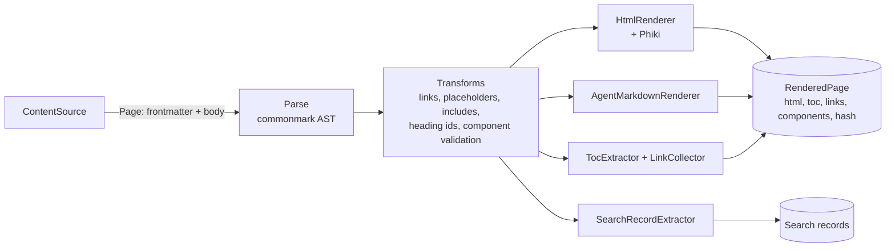
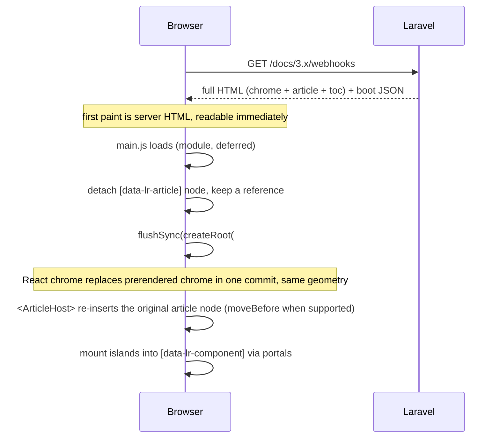
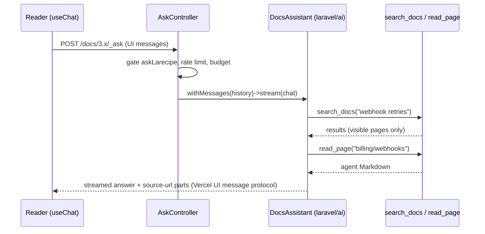
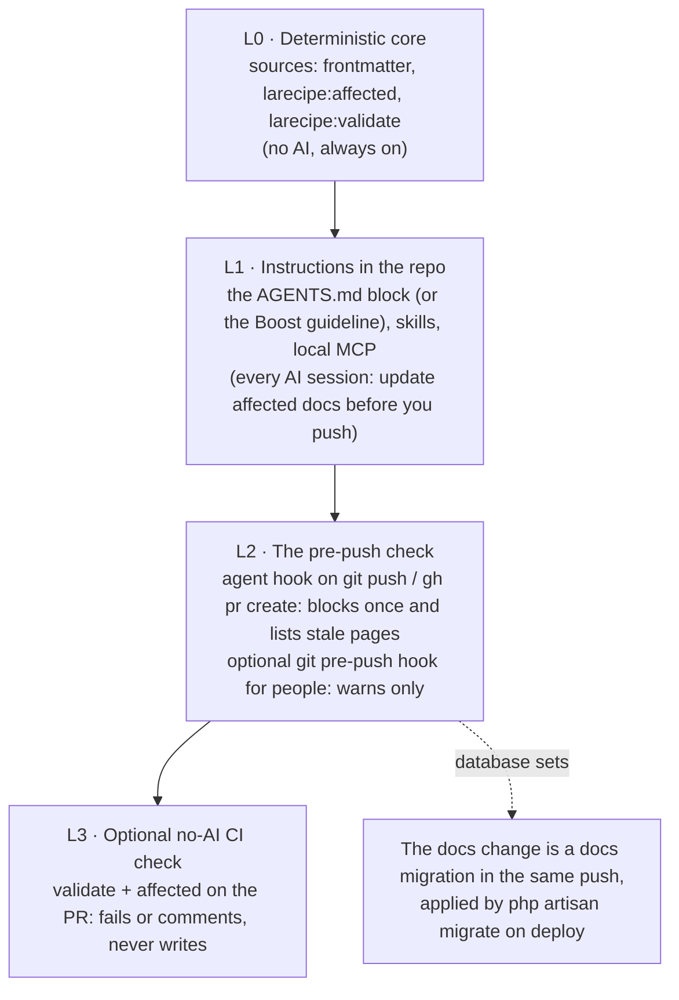

# LaRecipe v3 · Architecture

> The technical RFC for LaRecipe v3. What the system is made of, how a request becomes a page, how agents read and write docs, and what we refuse to build. Sits next to `PRODUCT.md`, `DESIGN.md`, `ART_DIRECTION.md` and `ROADMAP.md` (sequencing). This document does not specify visual design; every UI decision here is structural.

Status: RFC draft, 2026-10-17, revised the same day with the maintainer's review decisions (sources, agent workflow, review modes, docs migrations, search, onboarding, domains, custom components; agent instructions and a pre-push hook instead of a CI agent; no built-in traffic insight; no importers or in-app help). Package `larecipe/larecipe`, namespace `LaRecipe\` (confirmed by the maintainer, 2026-10-17). Facts about laravel/mcp, laravel/ai, Boost, Claude Code, Inertia, commonmark and Phiki were verified against vendor source and official docs. Anything not verified is marked *unverified*.

---

## 0. Decisions at a glance

| Area | Decision |
| --- | --- |
| Platform | Laravel-native Composer package now. Portable domains (no Laravel dependency outside their adapter folders) make a standalone CLI possible later. |
| Floor | PHP 8.3+, Laravel 12.62+ or 13.x. |
| Hard deps | `league/commonmark ^2.10.3`, `phiki/phiki ^2.2`, `laravel/mcp ^1.0`, `symfony/yaml`, `opis/json-schema`. |
| Optional deps | `laravel/ai ^1.2` (Ask AI, the server-side docs agent), `nikic/php-parser` (symbol-level drift). |
| Code layout | Backend split into domains (`src/Domains/{Domain}`), Nashra style: each owns its Actions, DTOs, Services, Queries, Models, Contracts and adapters. |
| Doc sets | One app serves one or more doc sets (`/docs`, `/api`, `/help`), each with its own route, driver, manifest, theme, access policy and agent surfaces. A single-set app needs no extra config. A set may mount at the domain root. |
| Content | Markdown + YAML frontmatter (page-level config) + `larecipe.json` (set manifest) + `navigation.json` (per version). This set of files is the canonical interchange format. Without `navigation.json`, navigation is derived from folders and frontmatter. |
| Sources | Two drivers: `repository` (docs in the app's own repo, recommended) and `database` (for teams that want an admin UI, always behind a cache). No separate docs repository. Lossless `larecipe:source:move` between them. |
| Database changes in PRs | Docs migrations: standard Laravel migrations in `database/migrations/docs/`, reviewed in the PR with the code, applied by `php artisan migrate` on deploy, reversible, conflict-safe. |
| Rendering | PHP renders HTML with commonmark + Phiki. Components are AST nodes rendered as server HTML islands. The same AST renders agent Markdown. Advanced: live references (`<Route>`, `<Artisan>`, `<Model>`, `<Event>`) read the host app at render time; gate blocks (`<Can>`) scope content per role. No component ever reads config or environment values. |
| UI | React 19 owns the whole UI, but every response is complete server HTML. React adopts the server-rendered article node; no Inertia, no SSR process, no Node in the host. |
| Assets | Prebuilt `dist/` served from vendor through a fingerprinted, immutable route (Livewire pattern). Optional publish to `public/`. |
| Customization | Tokens in `larecipe.json` → custom React components built with `@larecipe/vite`, used inline in Markdown or placed site-wide at named insert points (Phase 1) → override any built-in by name → eject (Phase 2). Custom components get runtime helpers (page context, a same-origin request helper for the host's own routes, design-system primitives) and always ship a server fallback and an agent-Markdown form. |
| Search | Internal and client-side by default: a fingerprinted JSON index per set, version, locale and audience, searched in the browser with MiniSearch (fuzzy and prefix). A small PHP ranker over the same records serves agents and Ask AI. No Algolia, no Scout; a `SearchDriver` contract for advanced custom engines. |
| Agent surfaces | `llms.txt` (capped and split), per-version `llms-full.txt`, `.md` URLs, `Accept: text/markdown`, Markdown 404s with suggestions, discovery hints and `Link` headers, MCP (web per set plus one stdio server), auto-generated `skill.md` and `/.well-known/agent-skills/index.json`, page actions, `larecipe:validate --json`, four authoring skills, hooks, Boost guidelines, an AGENTS.md docs index, Claude Code plugin marketplace. Graded against AFDocs in CI. |
| AI for readers | Ask AI panel: laravel/ai agent using the same tool classes as the MCP server, streamed with the Vercel UI message protocol. |
| AI for authors | The owner's own coding-agent session first (instructions in `AGENTS.md`, skills, hooks, local MCP). laravel/ai on the owner's provider key (`larecipe:sync`) only on demand, for extra power: an audit, a developer without a local agent. Never a CI default. |
| Keeping docs current | Docs changes land in the same push as the code. Instructions that `larecipe:install` writes into `AGENTS.md` tell every AI coding session to update affected docs before it pushes; a pre-push agent hook holds the push once if it forgot. No AI runs in CI; an optional no-AI CI check catches pushes made without an agent and never writes. |
| Review | Changes in a PR are reviewed in the PR. For changes made outside a PR, `review: required` (default) keeps agent edits as drafts; `review: auto` (owner opt-in) publishes them. Always revisioned and attributed. |
| Admin | A React admin area for the database source: page tree, Markdown editor with live preview, frontmatter, navigation and manifest forms, drafts, revisions and migration conflicts. |
| Analytics | No built-in traffic store or dashboards. Analytics integrations in `larecipe.json` (GA4, Plausible, Fathom, PostHog, custom script) and Laravel events (including agent requests, with a request-kind field) that hosts forward to their own tools. |
| Onboarding | `larecipe:install` can generate real starter docs from the app for chosen audiences, run by the owner's local coding agent with the `larecipe-write-docs` skill. Optional. |
| Static export | Advanced, opt-in `larecipe:export`. Works offline, search included. |
| Migration | Deterministic `larecipe:upgrade` plus the `larecipe-upgrade-v2` skill for everything not mechanically convertible. |

---

## 1. Principles

These are the rules every design decision in this document is checked against. When a proposal breaks one, it needs an explicit exception in this file.

**The One-Format Rule.** Markdown, YAML frontmatter, `larecipe.json` and `navigation.json` are the only canonical representation of a doc set. Every source driver reads and writes this format, every export produces it, every agent and the admin UI edit it. The database is a storage engine for the format, not a second format.

**The In-Repo Rule.** Docs live in the app's own repository by default, next to the code they describe, so one pull request can change both. The database is the alternative for teams who want an admin UI, and even then a change made in a PR travels in the repo as a docs migration. There is no third place: LaRecipe does not read docs from a separate repository.

**The HTML-First Rule.** Every docs URL returns complete, semantic server HTML: title, meta, navigation links, the full article and the table of contents. JavaScript enhances; it never gates content. Crawlers, LLM fetchers, `curl` and readers with JS disabled get the whole page.

**The Agent-Parity Rule.** Every human surface has an agent equivalent with the same content and the same access rules. A page has a `.md` twin. Search has `search_docs`. The sidebar has `list_pages`. The editor has `write_page`. If a human can see it, an authorized agent can read it in a token-efficient form.

**The Same-Rules Rule.** Access control is evaluated once, in one policy, for every surface: HTML, Markdown, JSON, `llms.txt`, `skill.md`, sitemap, search index, MCP and Ask AI. This holds for whole pages and for `<Can>` blocks inside a page. A private page or section never leaks through a side door.

**The No-Cloaking Rule.** Humans and agents get the same facts in different encodings. The `.md` twin is a projection of the same AST as the HTML, never a separately written or user-agent-sniffed variant. Request classification exists for analytics only and never changes content. AFDocs checks Markdown and HTML parity, and so does our test suite.

**The Deterministic-Core Rule.** Validation, link checking, navigation building and drift detection are deterministic and free. AI is layered on top of them, never underneath. A team with no API key still gets 80% of the value.

**The Owner-Session-First Rule.** The owner already runs a coding agent with full context of the change they just made. LaRecipe's first job is to make that session excellent at docs (skills, MCP tools, hooks, validation) at no extra cost. The server-side agent on the owner's `laravel/ai` key is the fallback for extra power, not the headline.

**The Same-PR Rule.** Docs changes land in the pull request that changes the code: as Markdown files for a repository set, as a docs migration for a database set. Instructions in the repo tell every AI coding session to update the affected docs before it pushes, and a pre-push hook holds the push once if it forgot. LaRecipe does not open follow-up docs PRs after merge, because by then the reviewer has moved on and the docs are already behind.

**The Check-Never-Write CI Rule.** No AI agent runs in CI by default. The agent that changed the code, with its full context, writes the docs before it pushes; CI can at most check that it did (the optional no-AI check) and never writes, commits or needs secrets.

**The Reviewable-Change Rule.** A change made in a PR is reviewed in the PR. A change made outside a PR (the server-side agent or remote author tools working on a database set) is a draft by default; an owner may opt into `review: auto`, where those changes go live without a separate review. In every mode, every change is revisioned, attributed (human or agent, with the PR, commit or migration) and one step from being reverted.

**The No-Secrets Rule.** No component, resolver or agent surface ever reads configuration or environment values. There is no `<Config>` and no `<Env>`. Live references read only the public shape of the app: route definitions, command signatures, model schemas, event payloads.

**The Zero-Node Rule.** A host app never needs Node.js on a server to install, run or deploy LaRecipe. Custom React components need Node only at build time, on a developer machine or in CI, where most Laravel apps already run Vite (the `@larecipe/vite` plugin adds one entry); the built files are static. Sites without custom components need no Node at all.

**The Portable-Domain Rule.** The domains a future CLI needs (listed in 3.3) keep Laravel out of everything except their adapter folders. An arch test enforces it, so the CLI can ship those domains with its own adapters without a rewrite.

---

## 2. Platform and dependencies

### 2.1 Version floor

| Requirement | Value | Why |
| --- | --- | --- |
| PHP | `^8.3` | Laravel 13 and laravel/ai both require it. Readonly classes, typed constants and `json_validate()` are used throughout. |
| Laravel | `^12.62 \|\| ^13.0` | laravel/ai needs `illuminate/json-schema ^12.62\|^13.15`; laravel/mcp needs 12.41.1+. One floor guarantees that `composer require laravel/ai` never conflicts on a supported install. |
| Databases | Any Laravel-supported DB for the `database` source. | No database-specific features are required. |
| Cache | Any persistent cache store for the `database` source. | The database source always runs behind a cache (5.5); `array` and `null` stores are rejected for it outside tests. |
| Git | `git` on developer machines and in CI, for `larecipe:affected` and provenance. Not required on production servers. | `larecipe:provenance` compiles provenance at build time when git is available; without the compiled index, pages fall back to file modification times (Laravel Cloud, Vapor, containers). |

Laravel 12 is in its security-only window. We support it at launch to avoid blocking upgrades, and drop it in the first minor release after Laravel 14 ships.

### 2.2 Dependencies

```jsonc
// composer.json (sketch)
{
  "name": "larecipe/larecipe",
  "require": {
    "php": "^8.3",
    "illuminate/support": "^12.62|^13.0",
    "league/commonmark": "^2.10.3",      // security fixes; correct handling of <Callout>-style tags
    "phiki/phiki": "^2.2",               // TextMate grammars, the larecipe-pass theme
    "laravel/mcp": "^1.0",               // MCP server, web + stdio; tool classes shared with Ask AI and larecipe:sync
    "symfony/yaml": "^7.2|^8.0",         // frontmatter
    "symfony/process": "^7.2|^8.0",      // git diff and log for affected pages and provenance; agent CLIs during onboarding
    "symfony/html-sanitizer": "^7.2|^8.0",
    "opis/json-schema": "^2.4",          // larecipe.json, navigation.json, frontmatter validation
    "laravel/prompts": "^0.3"
  },
  "bin": ["bin/larecipe-hook"],          // dependency-free agent hook entry point (14.3)
  "suggest": {
    "laravel/ai": "Ask AI for readers and the larecipe:sync docs agent (^1.2)",
    "nikic/php-parser": "Symbol-level sources (App\\Billing\\Invoice::refund) for drift detection"
  }
}
```

**Why laravel/mcp is a hard dependency.** Agent surfaces are the top priority, MCP is the primary one, and laravel/mcp is small, first-party and already inside our version floor. Making it optional would turn the headline feature into a setup step.

**Why laravel/ai is optional.** The primary author is the owner's own coding-agent session, which needs no provider key in the app. Ask AI and the server-side agent need a provider key, a provider choice and spending decisions that belong to the host app, and laravel/ai publishes its own config and migrations. `larecipe:install` offers to require it when the owner enables Ask AI or `larecipe:sync`. Feature detection lives in one place (`LaRecipe\Domains\Ask\Support\AiFeatures::available()`), never as scattered `class_exists` checks.

### 2.3 Frontend toolchain (package development only)

React 19, TypeScript (strict), Vite, Tailwind CSS v4 (CSS-first config, tokens as CSS variables), Radix primitives through shadcn/ui-style source components that we own, a small command palette of our own (no `cmdk`: it needed only a list, arrow keys and grouped results), MiniSearch for client-side search (lazy chunk), CodeMirror 6 for the admin editor (admin bundle only), `@ai-sdk/react` for Ask AI (lazy chunk), Lucide icons through one `Icons` namespace. pnpm workspaces. None of this is installed in the host.

---

## 3. Code layout: domains

### 3.1 Repository

```text
larecipe/
├── src/
│   ├── Domains/
│   │   ├── Content/          # doc sets, versions, pages, manifest and navigation loaders, schemas, zero-config navigation
│   │   ├── Sources/          # source contracts, repository and database drivers, the cache, docs migrations, drafts, moves
│   │   ├── Markdown/         # commonmark environment, components, HTML and agent Markdown renderers, TOC
│   │   ├── References/       # live references: resolver contract, Route, Artisan, Model, Event resolvers
│   │   ├── Access/           # page and block access policy, gates, share links
│   │   ├── Search/           # search records, client index builder, PHP ranker, SearchDriver contract
│   │   ├── Validation/       # validator and rules, the --json report
│   │   ├── Delivery/         # HTTP: routes, negotiation, Blade shell, assets, render cache, redirects, sitemap, feedback, analytics events
│   │   ├── Agents/           # llms.txt, llms-full.txt, skill.md, skills index, Markdown 404s, MCP server, AGENTS.md index, doctor
│   │   ├── Sync/             # affected pages, AGENTS.md instructions, the pre-push hook, the no-AI CI check, larecipe:sync, review modes
│   │   ├── Onboarding/       # larecipe:install, agent detection, skill installer, larecipe:onboard
│   │   ├── Ask/              # Ask AI agent, streaming endpoint, budgets
│   │   ├── Admin/            # admin UI API for the database source
│   │   ├── Upgrade/          # larecipe:upgrade (v2)
│   │   └── Export/           # static export
│   ├── Migrations/DocsMigration.php  # public base class for docs migrations (user code imports it)
│   ├── Support/              # the few cross-cutting helpers (Dispatcher contract, Clock, Paths)
│   ├── Facades/LaRecipe.php
│   └── LaRecipeServiceProvider.php   # registers each domain's provider
├── ui/                       # React app source (TypeScript): reader entry and admin entry; builds to dist/
│   ├── src/{app,admin,regions,components,markdown,islands,primitives,hooks,lib}
│   └── vite.config.ts
├── packages/
│   ├── ui/                   # @larecipe/ui: defineExtension, runtime helpers (useLaRecipe, request), design-system primitives
│   └── vite/                 # @larecipe/vite: builds host extensions with React externalized
├── bin/larecipe-hook         # tiny PHP entry point for agent hooks; boots artisan only for push and PR commands
├── dist/                     # built UI, committed on release tags by CI
├── resources/
│   ├── views/                # Blade shell (page, error, prerender partials)
│   ├── schemas/              # larecipe.schema.json, navigation.schema.json, frontmatter.schema.json, validate.schema.json
│   ├── boost/guidelines/core.blade.php
│   └── boost/skills/         # the four canonical skills; the installer and the plugin read from here
├── claude-plugin/            # hooks.json, slash commands and plugin assets
├── .claude-plugin/           # plugin.json + marketplace.json (the repo is a marketplace)
├── stubs/                    # docs scaffold, AGENTS.md block, hook settings, the optional no-AI CI check, docs migration stub
├── database/migrations/      # database source tables (loaded from the package; publish with --tag=larecipe-migrations to customize)
├── routes/{web.php,mcp.php,admin.php}
├── config/larecipe.php
└── tests/{Unit,Feature,Contracts,Arch,Browser}
```

User-facing classes live outside `Domains/` so host code never imports a domain internal: the `LaRecipe` facade and the `DocsMigration` base class. Both delegate to domain Actions.

### 3.2 Inside a domain

Each domain owns the same kinds of folders, created only when needed:

| Folder | Holds |
| --- | --- |
| `Actions/` | One use case per class, one public `execute()` method. The only entry point other domains may call for behavior. |
| `DTOs/` | `final readonly` data carriers with named constructors (`fromArray`, `fromRequest`). No behavior beyond small derived getters. |
| `Contracts/` | Interfaces the domain exposes (or expects others to implement). |
| `Services/` | Stateless collaborators used by the domain's own Actions. Private to the domain. |
| `Queries/` | Read models: one query per class, returning DTOs. Private to the domain. |
| `Models/` | Eloquent models (database source). Private to the domain. |
| `Enums/`, `Exceptions/`, `Support/` | What their names say. `Support/` is private to the domain. |
| `Events/`, `Listeners/` | Domain events other domains may listen to; this domain's listeners. |
| `Controllers/`, `Requests/`, `Commands/`, `Mcp/` | Laravel adapters: HTTP, form requests, artisan commands, MCP tools. |
| `Laravel/` | Other Laravel adapters (resolvers backed by the router, the console kernel, Eloquent; the migration writer). |
| `{Domain}ServiceProvider.php` | Binds contracts, registers commands, routes, migration paths and listeners. |

A domain may add a folder for a concept it owns (`Markdown/Components/`, `Sources/Drivers/`) when that reads better than forcing it into `Support/`.

Sample tree:

```text
src/Domains/Sources/
├── Actions/          WritePageAction, MovePageAction, DeletePageAction, UpdateNavigationAction,
│                     UpdateManifestAction, PublishDraftAction, RevertPageAction,
│                     ApplyDocsMigrationAction, RollbackDocsMigrationAction, MoveSourceAction
├── Commands/         SourceMoveCommand, MakeDocsMigrationCommand, PullCommand, CacheWarmCommand
├── Contracts/        ContentSource, WritableContentSource, DraftableContentSource
├── Drivers/          RepositorySource, CachedSource
├── DTOs/             PageDraft, WriteResult, DocsMigrationOperation, MigrationOutcome, MovePlan, Bundle
├── Enums/            WriteMode, RevisionStatus, RevisionOperation
├── Events/           PageWritten, DraftCreated, DraftPublished, DocsMigrationConflicted, ContentChanged
├── Laravel/          DatabaseSource, DocsMigrationWriter, GitProvenanceResolver
├── Mcp/              WritePageTool, MovePageTool, DeletePageTool, UpdateNavigationTool, UpdateManifestTool
├── Models/           Page, Revision, Navigation, Manifest, Asset, DocsMigrationRecord
├── Queries/          DraftsQuery, ConflictsQuery, RevisionHistoryQuery
├── Services/         SourceManager, ReviewPolicy
└── SourcesServiceProvider.php
```

An Action and a DTO in the house style:

```php
namespace LaRecipe\Domains\Sources\Actions;

use LaRecipe\Domains\Sources\DTOs\PageDraft;
use LaRecipe\Domains\Sources\DTOs\WriteResult;
use LaRecipe\Domains\Sources\Events\PageWritten;
use LaRecipe\Domains\Sources\Services\ReviewPolicy;
use LaRecipe\Domains\Sources\Services\SourceManager;
use LaRecipe\Domains\Validation\Actions\ValidatePageAction;
use LaRecipe\Support\Contracts\Dispatcher;

/**
 * Writes one page on behalf of a person or an agent.
 *
 * Every writer goes through this action (MCP tools, the admin UI, larecipe:sync,
 * docs migrations, onboarding), so validation, the review mode and provenance are
 * applied the same way no matter who is writing.
 */
final class WritePageAction
{
    public function __construct(
        private readonly SourceManager $sources,
        private readonly ReviewPolicy $review,
        private readonly ValidatePageAction $validate,
        private readonly Dispatcher $events,
    ) {}

    public function execute(PageDraft $draft): WriteResult
    {
        $report = $this->validate->execute($draft->page);

        if ($report->hasErrors()) {
            return WriteResult::rejected($report);
        }

        $source = $this->sources->writableFor($draft->page->ref->set);
        $mode = $this->review->modeFor($draft);

        $revision = $source->writePage($draft->page, $draft->author, $mode);

        $this->events->dispatch(new PageWritten($revision));

        return WriteResult::written($revision, $report);
    }
}
```

```php
namespace LaRecipe\Domains\Sources\DTOs;

use LaRecipe\Domains\Content\DTOs\Page;
use LaRecipe\Domains\Content\DTOs\Provenance;

/**
 * A page someone wants to write, who is writing it, and where the change came from.
 */
final readonly class PageDraft
{
    public function __construct(
        public Page $page,
        public Provenance $author,
        public Channel $channel,          // PullRequest (a docs migration or repo files), AdminUi, RemoteAgent, Sync
        public ?string $summary = null,   // one line for the revision list and the PR comment
    ) {}

    public static function fromArray(array $data, Provenance $author, Channel $channel): self
    {
        return new self(
            page: Page::fromArray($data['page']),
            author: $author,
            channel: $channel,
            summary: $data['summary'] ?? null,
        );
    }
}
```

**Readability rules.** Small classes with explicit names (`RollbackDocsMigrationAction`, not `MigrationManager`). One job per Action. Docblocks explain why the class exists, not what each line does. No magic: no `__call`, no string-built class names, no service locator calls inside domain code (constructor injection only), no traits that hide behavior. A new contributor should be able to open one domain and understand it without reading the others.

### 3.3 Domains, responsibilities and dependencies

| Domain | Responsibility | Portable |
| --- | --- | --- |
| Content | Doc sets, versions, locales, pages, provenance; `larecipe.json` and `navigation.json` loaders, their schemas and the frontmatter schema; zero-config navigation. | Yes |
| Sources | Source contracts; the `repository` and `database` drivers; the cache in front of the database; writes, moves, drafts, revisions, review modes; docs migrations; source moves and bundles. | Yes (database driver and migration writer in `Laravel/`) |
| Markdown | The commonmark environment and extensions, the component registry and built-ins, the HTML and agent Markdown renderers, TOC and link extraction. | Yes |
| References | Live references: the resolver contract and value objects (portable); route, artisan, model and event resolvers (in `Laravel/`). | Yes |
| Access | One policy for pages and `<Can>` blocks behind an `Authorizer` contract (Laravel gates in `Laravel/`); share links. | Yes |
| Search | Search records from the AST, client index variants, the PHP ranker, the `SearchDriver` contract. | Yes |
| Validation | Every validation rule and the `--json` report. | Yes |
| Delivery | Routes, controllers, content negotiation, the Blade shell, assets, the render cache, redirects, sitemap; the feedback endpoint and `submit_feedback` tool; analytics integrations, request classification and the traffic events. | No |
| Agents | `llms.txt`, `llms-full.txt`, `skill.md`, the skills index, Markdown 404s and discovery hints; composes the MCP server from tools owned by other domains; the AGENTS.md docs index; the `doctor` report. | Yes (MCP server in `Mcp/`) |
| Sync | Affected pages and source suggestions; the `AGENTS.md` instructions block; `larecipe:hook` (the pre-push check and SessionStart map); the optional no-AI CI check scaffold; `larecipe:sync`. | Yes (git runner and AI agent in `Laravel/`) |
| Onboarding | `larecipe:install`, agent CLI detection, skill and MCP config installation, `larecipe:onboard` and its audience presets. | No |
| Ask | The Ask AI agent, its streaming endpoint, rate limits and budgets. | No |
| Admin | The admin API and controllers for the database source. | No |
| Upgrade | `larecipe:upgrade` for v2. | Yes (commands in `Commands/`) |
| Export | Static export. | Yes |

**Dependency rules.**

- A domain may use another domain's **Actions, Contracts, DTOs, Enums and Events**. Never its Services, Queries, Models or Support classes. If a domain needs something that is internal elsewhere, the owner adds an Action.
- Dependencies point down this order and never form a cycle: Content → Markdown and References → Access → Sources → Search → Validation → Agents and Sync → Delivery, Ask, Admin, Onboarding, Upgrade, Export.
- **Write tools live in the domain that owns the behavior** (`Sources/Mcp/WritePageTool`, `Sync/Mcp/AffectedPagesTool`, `Validation/Mcp/ValidateDocsTool`); the read tools (`search_docs`, `read_page`, `list_pages`, `submit_feedback`) live with the server in `Agents/Mcp/Tools`, since they only compose Search and Content actions. Domains register their tools with `LaRecipe::mcpTool()`, and the Agents domain composes them into the server; Ask and Sync reuse the same actions as laravel/ai tools. That keeps Agents, Ask and Sync from depending on each other.
- Domains talk through events for anything that is not a direct call: `ContentChanged` warms caches, `PageWritten`, `DraftPublished` and `DocsMigrationConflicted` feed the admin UI, and the traffic events reach the host's own listeners.
- An arch test (`pestphp/pest-plugin-arch`) encodes the allowed-dependency matrix and fails CI on a violation.

**Portability.** In portable domains, no file outside `Controllers/`, `Requests/`, `Commands/`, `Models/`, `Listeners/`, `Mcp/`, `Laravel/` and the domain service provider may reference `Illuminate\`, `Laravel\`, a facade, or a global helper (`config()`, `app()`, `event()`, `now()`). Portable Actions receive configuration as DTOs, dispatch events through `LaRecipe\Support\Contracts\Dispatcher`, and read time through `Clock`. When the CLI arrives, it ships the portable domains with its own adapters; no class is renamed.

**dist/ policy.** Contributors never commit `dist/`. A release workflow builds it from the tagged source, commits it to the tag, and publishes npm packages with provenance. A CI check rejects PRs that touch `dist/` by hand.

---

## 4. Content model

### 4.1 Entities

```php
namespace LaRecipe\Domains\Content\DTOs;

final readonly class DocSet    { public function __construct(public string $key, public Manifest $manifest, /** @var Version[] */ public array $versions) {} } // key: "docs", "api", "help"
final readonly class Version   { public function __construct(public string $id, public string $label, public VersionStatus $status, public bool $default, public Visibility $visibility) {} }
final readonly class Locale    { public function __construct(public string $code, public string $label, public Direction $dir) {} }

final readonly class PageRef   { public function __construct(public string $set, public string $version, public string $locale, public string $path) {} } // path: "guides/installation"

final readonly class Page
{
    public function __construct(
        public PageRef $ref,
        public string $title,
        public ?string $description,
        public Frontmatter $frontmatter,     // validated against frontmatter.schema.json
        public string $body,                 // raw Markdown without frontmatter
        public array $sources,               // globs this page documents, e.g. ["app/Billing/**", "routes/billing.php"]
        public string $contentHash,          // sha256 of frontmatter + body; the cache key and the docs-migration conflict check
        public ?\DateTimeImmutable $updatedAt,
        public ?Provenance $provenance,
    ) {}
}

final readonly class Provenance
{
    public function __construct(
        public Actor $actor,                 // Actor::Human | Actor::Agent | Actor::Migration
        public ?string $name,                // "Saleem Hadad", "claude-code", "larecipe:sync"
        public ?string $ref,                 // commit sha, PR URL, revision id, docs migration name
        public ?\DateTimeImmutable $at,
    ) {}
}
```

**Identity.** A page is identified by `(set, version, locale, path)`. Paths are lowercase, slash-separated, without extension. `index` is implicit for folders. Most apps have one set (`docs`), so the set key rarely appears in URLs or commands; it is always present in the model so a second set never needs a migration.

**Provenance is metadata, not frontmatter.** It comes from the source: git history for `repository` (commit author, `Co-Authored-By` trailers that name an agent, PR references in commit messages), compiled at build time by `larecipe:provenance`; the revisions table for `database`, where a docs migration records the PR and the agent that wrote it. The UI uses it for "Updated 3 days ago by Claude Code, PR #412". Readers and reviewers deserve to know what an agent wrote; authors should not have to maintain it by hand.

### 4.2 The set manifest: `larecipe.json`

One per doc set, at the root of the set's content. Presentation and content structure only (see the Two-Files Rule in 4.5). Theme tokens live here, so each set can look different (a public `/docs` and an internal `/handbook` in the same app).

```jsonc
{
  "$schema": "https://larecipe.saleem.dev/schemas/3.x/larecipe.json",
  "name": "Acme",
  "description": "Billing infrastructure for Laravel apps.",
  "logo": { "light": "/logo.svg", "dark": "/logo-dark.svg" },
  "favicon": "/favicon.svg",
  "repository": { "url": "https://github.com/acme/acme", "branch": "main", "docsPath": "docs" },
  "theme": { "accent": "#6d5efc", "radius": "sharp", "fonts": { "sans": "Inter", "mono": "JetBrains Mono" }, "mode": "system" },
  "versions": [
    { "id": "3.x", "default": true },
    { "id": "2.x", "status": "maintained" },
    { "id": "1.x", "status": "archived", "visibility": "public" }
  ],
  "locales": [{ "code": "en", "default": true }, { "code": "ar", "dir": "rtl" }],
  "landing": "introduction",
  "navbar": { "links": [{ "label": "Changelog", "href": "/changelog" }], "cta": { "label": "Dashboard", "href": "/app" } },
  "redirects": [{ "from": "/docs/3.x/setup", "to": "/docs/3.x/installation", "status": 301 }],
  "assets": { "css": ["theme.css"] },
  "inserts": { "article.after": ["Subscribe"] },
  "integrations": { "analytics": { "plausible": { "domain": "acme.dev" } } },
  "agents": { "llmsTxt": { "description": "Acme is a billing package for Laravel.", "instructions": "Prefer the 3.x pages." }, "skillMd": true, "context7": true },
  "provenance": true
}
```

The schema ships at `resources/schemas/larecipe.schema.json` and is also served from the docs site, so IDEs and agents validate edits without network access. `larecipe:install` writes the `$schema` pointer.

### 4.3 Navigation: `navigation.json` per version

Navigation lives with the content it describes, inside each version root. A single-version set keeps both files side by side.

```jsonc
// docs/3.x/navigation.json
{
  "$schema": "https://larecipe.saleem.dev/schemas/3.x/navigation.json",
  "tabs": [
    {
      "label": "Guides",
      "groups": [
        { "label": "Get started", "icon": "rocket", "pages": ["index", "installation", "configuration"] },
        { "label": "Billing", "pages": ["billing/overview", { "group": "Webhooks", "pages": ["billing/webhooks", "billing/events"] }] }
      ]
    },
    { "label": "API reference", "href": "/docs/3.x/api" }
  ]
}
```

**Zero-config fallback.** No `navigation.json` means navigation is derived: folders become groups (label from the folder's `index.md` title or a humanized name), pages sort by frontmatter `order` then title, `hidden: true` pages are routable but unlisted. `php artisan larecipe:navigation:freeze` writes the derived tree to `navigation.json` when a team wants explicit control.

### 4.4 Frontmatter (page-level only)

YAML frontmatter configures one page. It never holds set-level settings or navigation structure; those belong to `larecipe.json` and `navigation.json`.

```yaml
---
title: Webhooks                       # required unless the first H1 provides it
description: Receive signed events from Acme.   # llms.txt, meta tags, search snippets, MCP list_pages
order: 20                             # used by zero-config navigation
icon: webhook
sources: ["app/Webhooks/**", "routes/webhooks.php"]
tags: [billing, events]
badge: { label: "New", tone: "info" }
since: "3.1"
deprecated: false
hidden: false
noindex: false
visibility: public                    # public | private (evaluated by the viewLarecipe gate)
redirect_from: ["/docs/3.x/hooks"]
layout: default                       # default | wide | full (replaces v2 show_side_bar)
inserts: { article.after: false }     # opt out of a site-wide insert point on this page (false turns off all of them)
type: page                            # page | openapi (Phase 4, with spec: url, path, scramble or scribe)
---
```

Values for extensions go under `meta:` (`meta: { audience: developers }`) and reach the UI as `page.meta`. Other unknown keys are allowed but stay on the server, since they often hold notes for the team (an owner, a ticket). `larecipe:validate` warns on keys that look like typos of known keys.

### 4.5 The Two-Files Rule

Infrastructure lives in `config/larecipe.php`: doc sets, routes, middleware, the driver, cache, review mode, search driver, AI provider and budgets, MCP exposure, access mode. Content and presentation live in `larecipe.json` and `navigation.json`, with page-level settings in frontmatter: they travel with the content, agents and the admin UI edit them, and switching sources never touches them. Secrets never go in JSON or frontmatter.

Top-level keys are defaults for every set; a set may override any of them. The published config ships with one `docs` set, so a single-set app never thinks about sets.

```php
// config/larecipe.php (abridged)
return [
    'default' => 'docs',                     // the set used by commands and the local MCP server when none is given

    'sets' => [
        'docs' => [
            'route'  => ['prefix' => 'docs', 'domain' => null, 'middleware' => ['web']],   // prefix '' mounts at the domain root
            'source' => ['driver' => 'repository', 'path' => base_path('docs')],
            'access' => ['mode' => 'public'],                                                 // public | auth | gate
        ],

        // A second set: internal runbooks, managed in the admin UI, signed-in staff only.
        'handbook' => [
            'route'  => ['prefix' => 'handbook', 'middleware' => ['web', 'auth']],
            'source' => ['driver' => 'database', 'connection' => null, 'cache' => 'redis'],
            'access' => ['mode' => 'gate'],
            'mcp'    => ['web' => ['enabled' => false]],
            'ai'     => ['ask' => ['enabled' => true]],
        ],
    ],

    // Defaults for every set
    'review' => 'required',                  // required | auto (governs changes made outside a PR)
    'cache'  => ['store' => null],
    'search' => ['driver' => 'client'],      // client (default) | server | a custom driver name
    'migrations' => ['path' => database_path('migrations/docs'), 'skip_in_tests' => false],
    'ai'     => ['ask' => ['enabled' => false, 'provider' => null, 'max_steps' => 6, 'rate_limit' => '10,1'], 'sync' => ['provider' => null, 'max_pages' => 20]],
    'mcp'    => ['web' => ['enabled' => true, 'path' => 'mcp', 'author_tools' => false], 'local' => true],   // web path is relative to each set's prefix
    'agents' => ['markdown' => true, 'llms_txt' => true, 'skill_md' => true, 'well_known_skills' => true, 'ask_endpoint' => false, 'webmcp' => false, 'server_card' => false],
    'references' => ['models' => ['allow' => ['App\\Models\\*']]],
];
```

### 4.6 Doc sets

A doc set is an independent documentation site inside one app: `/docs` for the public product, `/api` for the API reference, `/help` for customers, `/handbook` for staff. This was the most-requested v2 feature (issue #6). Each set has:

| Owns | Shared across sets |
| --- | --- |
| Route prefix (or the domain root), optional domain, middleware | The package, the UI build and its extensions |
| One source driver and its root (a folder, or rows scoped by set key) | Config defaults (cache, review, search, AI provider) unless overridden |
| `larecipe.json` (name, theme, navbar, versions, locales) and its navigation | The PHP extension registry (components, Markdown extensions) |
| Access policy (`access.mode` plus the gates, which receive the set) | Event stream and analytics store (events carry the set key) |
| Agent surfaces: its own `llms.txt`, `llms-full.txt`, `skill.md`, MCP web endpoint, sitemap and search index | The local stdio MCP server (one server, a `set` argument) |

`LaRecipe\Domains\Content\Services\SetRegistry` resolves sets from config, and `LaRecipe::set('handbook')` returns a set-scoped facade for code. Sets never link to each other implicitly; a cross-set link is a normal absolute URL, and `larecipe:validate` checks it like an internal link when it points at a known set. The multi-set data model, routing and agent surfaces ship in Phase 1; a set switcher in the UI comes later.

**Mounting at the root.** A set with `prefix => ''` owns the domain root, and its landing page (the manifest's `landing`, or the default version's `index`) is the site's front page. LaRecipe's own site works this way: larecipe.saleem.dev opens on the docs Introduction page, with no separate marketing homepage (the larecipe-docs track in `ROADMAP.md`).

---

## 5. Content sources

### 5.1 Contracts

```php
namespace LaRecipe\Domains\Sources\Contracts;

interface ContentSource
{
    public function manifest(): ?Manifest;
    /** @return iterable<PageRef> */
    public function pages(string $version, string $locale): iterable;
    public function page(PageRef $ref): ?Page;
    public function navigation(string $version, string $locale): ?NavigationTree;   // null means zero-config
    public function asset(string $version, string $path): ?Asset;                    // images, theme.css
    public function fingerprint(?string $version = null): string;                    // changes whenever content changes
}

interface WritableContentSource extends ContentSource
{
    public function writePage(Page $page, Provenance $by, WriteMode $mode = WriteMode::Publish): Revision;
    public function movePage(PageRef $from, PageRef $to, Provenance $by, WriteMode $mode = WriteMode::Publish): Revision;
    public function deletePage(PageRef $ref, Provenance $by, WriteMode $mode = WriteMode::Publish): Revision;
    public function writeNavigation(string $version, string $locale, NavigationTree $tree, Provenance $by, WriteMode $mode = WriteMode::Publish): Revision;
    public function writeManifest(Manifest $manifest, Provenance $by, WriteMode $mode = WriteMode::Publish): Revision;
    public function writeAsset(string $version, string $path, string $contents): void;
}

interface DraftableContentSource extends WritableContentSource
{
    /** @return iterable<Revision> drafts, including conflicts raised by docs migrations */
    public function drafts(?string $version = null): iterable;
    public function publish(Revision $draft, Provenance $by): void;
    public function reject(Revision $draft, Provenance $by, ?string $reason = null): void;
    public function revert(PageRef $page, Revision $to, Provenance $by): Revision;
}
```

A source instance is bound to one doc set. The `database` driver scopes every query by set key, so one connection can host many sets; `repository` sets point at different folders.

`SourceManager` extends Laravel's `Manager`. Third parties may add drivers with `LaRecipe::extendSources('notion', fn ($app, array $config) => new NotionSource($config))`, but the two built-in drivers are the supported path. Every driver must pass the shared contract test suite (`tests/Contracts/ContentSourceContract.php`), which is published so third-party drivers can run it too.

**One driver per set.** Versions are folders (repository) or a column (database) inside the set's one driver; a set cannot serve one version from the repository and another from the database. Per-version drivers made source moves, provenance, caching, docs migrations and the admin UI harder to reason about, and their main use case (old versions in another repository) went away with the remote git source.

### 5.2 `repository` (default, recommended)

- Reads `docs/` at the app's repo root by default. Root-level `docs/` is what GitHub, agents and humans expect; v2's `resources/docs` keeps working by config. Additional sets point at their own folders (`handbook/`, `docs-api/`).
- Layout: `docs/larecipe.json`, `docs/{version}/navigation.json` (optional), `docs/{version}/**/*.md`, `docs/{version}/_assets/**`. Single-version sets may omit the version folder.
- Writable. Writes go to the working tree, so they become part of the developer's next commit and the PR. `WriteMode` has no effect here: review happens in the pull request.
- Provenance from git history, compiled at build time by `larecipe:provenance` (file mtimes when git is unavailable).
- Fingerprint: in local env, a cheap mtime scan; in production, the compiled index from `larecipe:optimize` (6.6), so requests never scan the disk.

### 5.3 `database`

For teams that want to manage docs in an admin UI (section 15), generate pages from data, or keep docs content out of the repo for organizational reasons.

```text
larecipe_pages            id, set, version, locale, path, title, description, frontmatter (json), body (longText),
                          content_hash, published_revision_id, timestamps
larecipe_navigation       id, set, version, locale, tree (json), content_hash, published_revision_id, timestamps
larecipe_manifest         id, set, manifest (json), content_hash, published_revision_id, timestamps
larecipe_revisions        id, set, subject_type (page|navigation|manifest), subject_id, operation (write|move|delete),
                          version, locale, path, path_before, payload (json: frontmatter, body, tree or manifest),
                          content_hash, based_on_hash, replaces_id, conflict (json), migration, review_note,
                          status (draft|published|superseded|rejected|reverted|conflict),
                          actor (human|agent|migration), actor_name, actor_ref, channel (pull_request|admin_ui|remote_agent|sync),
                          summary, reviewed_by, reviewed_at, published_at, created_at
larecipe_assets           id, set, version, path, disk, disk_path, mime, size, hash
larecipe_docs_migrations  id, migration, set, operations (json: subject, revision created, revision replaced), conflicts (json), applied_at
```

- Implements `DraftableContentSource`. Every change is a revision with provenance.
- Changes made in a PR arrive as docs migrations (5.4) and publish when they are applied. Changes made outside a PR follow the review mode (14.6).
- Models are configurable (`larecipe.models.page`, ...) the way Sanctum and Cashier allow, so hosts can add scopes, tenancy or observers.
- Assets live on any Laravel filesystem disk.

### 5.4 Docs migrations: database changes that ride in the PR

A database set's content is not in the repo, so a pull request cannot carry its docs change as Markdown files. Docs migrations solve that: when the source is `database`, a content change made for a PR is written as a migration file in the repo, reviewed in the PR with the code, and applied on deploy.

**They are standard Laravel migrations.** The package registers one extra migration path with `loadMigrationsFrom()` when any set uses the database driver, so `php artisan migrate`, which every Laravel deploy already runs, applies them. There is no new deploy step, no new command to remember, and `migrate:status`, `migrate:rollback` and `--pretend` work as usual.

**The path is `database/migrations/docs/`.** It sits inside the app's existing migrations tree, where developers and agents already look, and it is a subfolder so content migrations stay visibly separate from schema migrations in a PR and either kind can be targeted with `migrate --path`. It is deliberately not inside `docs/`, which is the content folder of a repository set and would be confusing next to it. The path is configurable (`larecipe.migrations.path`).

```php
<?php
// database/migrations/docs/2026_10_17_141502_docs_document_agents_flag.php

use LaRecipe\Migrations\DocsMigration;

return new class extends DocsMigration
{
    protected string $set = 'handbook';
    protected string $author = 'claude-code';                  // provenance shown on the page
    protected string $ref = 'https://github.com/acme/acme/pull/482';
    protected string $summary = 'Document the --agents flag on larecipe:install';

    public function up(): void
    {
        $this->updatePage('3.x/installation', basedOn: 'sha256:9f3a2c…', frontmatter: [
            'title' => 'Installation',
            'description' => 'Add LaRecipe to any Laravel app.',
            'sources' => ['src/Domains/Onboarding/**'],
        ], body: <<<'MD'
            # Installation

            Run the installer and choose which coding agents to connect:

            ```bash
            php artisan larecipe:install --agents=claude,codex
            ```
            MD);

        $this->createPage('3.x/agents/connect', frontmatter: [
            'title' => 'Connect your agents',
            'sources' => ['src/Domains/Agents/**'],
        ], body: <<<'MD'
            # Connect your agents
            ...
            MD);

        $this->updateNavigation('3.x', basedOn: 'sha256:51be07…', patch: [
            ['add' => 'agents/connect', 'group' => 'Agents', 'after' => 'agents/mcp-server'],
        ]);
    }
};
```

- **Declarative operations:** `createPage`, `updatePage`, `movePage`, `deletePage`, `updateNavigation` (a full tree or a patch) and `updateManifest` (a JSON merge patch). Page bodies are inline nowdoc heredocs, so the PR diff reads as Markdown. Each operation calls the same Sources Actions as every other writer (`WritePageAction` and friends), with `Actor::Migration` plus the migration's `author` and `ref` for provenance.
- **`down()` is built in.** The base class records, per operation, the revision it created and the revision it replaced (in `larecipe_docs_migrations`). `migrate:rollback` restores each replaced revision as a new revision, removes created pages and restores deleted ones. If a subject changed again after the migration (someone edited it in the admin UI), rollback does not clobber that edit: it raises a conflict draft instead and reports it.
- **Conflict safety.** Every update, move, delete and navigation or manifest change records the content hash it was written against (`basedOn`). If production changed since (an admin UI edit, an auto-mode agent write), the migration does not overwrite: it lands its change as a draft with status `conflict`, holding both versions, emits `DocsMigrationConflicted`, and prints a warning in the `migrate` output. `createPage` on a path that already exists is a conflict too. The migration still completes, so a docs conflict never fails a deploy. The admin UI shows conflicts at the top of the review queue with a side-by-side resolve view.
- **Review.** The PR is the review. A docs migration applies as published revisions on deploy in both review modes; the review mode governs only changes made outside a PR (14.6).
- **Assets** are not carried by docs migrations in 3.0. Pages reference images by URL, or a person uploads them in the admin UI. Revisit if agents need to add images to database sets.

**How migrations get written.**

- **The local MCP server.** When the configured source is `database`, the author tools (`write_page`, `move_page`, `delete_page`, `update_navigation`, `update_manifest`) do two things: they apply the change to the developer's local database so the docs can be previewed at once, and they write it into the branch's docs migration (`database/migrations/docs/{timestamp}_docs_{branch}.php`). There is one file per branch, rewritten as the session continues, so the PR carries one readable file instead of dozens. The file is marked as already run locally, so a local `php artisan migrate` does not apply it twice.
- **Humans:** `php artisan larecipe:make:docs-migration document_billing_exports` scaffolds an empty docs migration with the current hashes of the pages you name (`--page=3.x/billing/exports`).
- **`larecipe:sync`,** run on demand, writes migrations the same way (13.6).
- **The skills know it.** `larecipe-write-docs` and `larecipe-update-docs` tell the agent that on a database set it edits through the MCP tools (never by hand-writing SQL or editing rows), and that the migration file is part of the change to commit and push. The `AGENTS.md` instructions and the pre-push hook (14.2, 14.3) apply to database sets the same way: no push without the docs migration.

**Starting from what is live.** A developer's local database can lag behind production. `php artisan larecipe:pull --set=handbook --from=handbook.zip` refreshes a local or CI database set from a bundle that `larecipe:source:export` made on production, so new migrations record production's hashes. (Pulling straight through the production MCP endpoint is not in 3.0.) The conflict check covers anything `pull` missed.

**In the host's test suite,** docs migrations run like any other migration (they are small inserts). Teams that prefer to skip their bodies in tests set `larecipe.migrations.skip_in_tests`.

**Admin UI edits in production** are direct database changes, saved as revisions. They do not create migration files. A team that wants those edits back in git runs `larecipe:source:move database repository` (or `larecipe:source:export`) and commits the result.

### 5.5 The database always runs behind a cache

**The Cached-Database Rule.** A database set never reads the database to serve a cached page. `CachedSource` wraps `DatabaseSource` and is not optional.

- The set's fingerprint (the highest published revision id) lives in the cache store and is bumped by every publish (admin UI, auto-mode writes, docs migrations), so serving never queries for it.
- The manifest, the page list, each page, navigation, rendered HTML and Markdown, search index variants, `llms.txt` and `skill.md` are cached per fingerprint, with no TTL.
- Publishing dispatches `ContentChanged`; a queued listener warms the changed pages and the indexes. `php artisan larecipe:cache:warm --set=handbook` warms the source cache: the manifest, and for every version and locale the page list, each page and the navigation (deploy scripts call it after `migrate`). Rendered pages and search indexes fill on first request.
- A warm request for a cached page runs zero database queries; a test asserts it.
- The configured cache store must be persistent. `larecipe:validate` and `larecipe:doctor` fail a database set on the `array` or `null` store outside tests.

### 5.6 Switching sources at any time

Because both drivers speak the One-Format Rule, moving is a copy plus a proof.

```bash
php artisan larecipe:source:move repository database --set=docs --dry-run   # plan: pages, navigation, manifest, assets, warnings
php artisan larecipe:source:move repository database --set=docs --verify    # copy, then re-read and compare hashes
php artisan larecipe:source:move database repository --set=docs --verify    # and back, into docs/
php artisan larecipe:source:export --set=docs --to=storage/docs.bundle      # backup or hand-off as a directory or .tar.gz
php artisan larecipe:source:import storage/docs.bundle --set=docs
```

The move pipeline: `snapshot(from)` → `Bundle` (canonical files in a temp directory) → validate → `write(to)` with `Actor::Migration` provenance → re-read from the target → compare normalized content hashes for every page, navigation tree, manifest and asset → report. Revision history is not migrated across drivers (git history and revision tables are not equivalent); the report says so. The command prints the config change that switches serving to the new driver; it does not edit `config/larecipe.php` itself.

---

## 6. Rendering pipeline

### 6.1 Stages



One parse, many renderers. The AST is the contract; HTML, agent Markdown, search records and validation data are all projections of it, so they can never disagree.

### 6.2 Markdown dialect

| Feature | Implementation |
| --- | --- |
| CommonMark + GFM (tables, task lists, strikethrough, autolinks) | `GithubFlavoredMarkdownExtension` |
| Frontmatter | `FrontMatterExtension` (frontmatter-only fast path for navigation and indexes) |
| Heading ids and permalinks | `HeadingPermalinkExtension` with clean `#slug` ids (`id_prefix` and `fragment_prefix` empty) |
| Explicit ids and classes | `AttributesExtension` with an allowlist (`id`, `class`), `on*` blocked |
| Footnotes, description lists | bundled extensions |
| Callouts, portable form | GitHub alerts: `> [!NOTE]`, `[!TIP]`, `[!IMPORTANT]`, `[!WARNING]`, `[!CAUTION]` |
| Callouts and layout, directive form | `:::name Title {key=value}` container directives (block start parser at priority 80, nested with longer fences) |
| Components, MDX-like form | PascalCase tags on their own lines: `<Tabs>`, `<Callout type="warning">`, self-closing `<Video src="..." />` (custom block parser at priority 45, before `HtmlBlock` at 40) |
| Code | Phiki with one dark theme (`larecipe-pass`, from the design tokens), so code reads the same in light and dark pages; info-string meta for `title="..."`, `{2,4-6}` highlights, `diff`, line numbers; consecutive fences inside `<CodeGroup>` become tabs |
| Snippet includes | `<<< @/app/Billing/Invoice.php#refund` pulls a region from real code (the Real-Code Rule below) |
| Internal links | Relative `.md` links (`./installation.md#env`) resolve to routes, so docs render correctly on GitHub too. `{{version}}` still works for v2 content. |
| Diagrams and math | ` ```mermaid ` and `$$` blocks render as lazy islands with a readable fallback (the source in a `<pre>`) |

**Directives and tags are the same thing.** `:::callout` and `<Callout>` both produce a `ComponentNode(name, props, children)`. Authors and agents pick the syntax they like; the renderer sees one node type. Props are strings, booleans or JSON strings; JSX expressions are not supported (there is no PHP MDX parser, and we will not require Node).

**Raw HTML is escaped by default** (`html_input: escape`). Component tags are recognized by the custom parser, not by enabling raw HTML. A `repository` set can opt into `html_input: allow`.

**The Real-Code Rule.** Code samples that describe the host app should come from the host app. Snippet includes resolve only inside configured roots (default: the repo root for `repository`; disabled for `database` unless a root is configured). A missing region is a validation error, which makes stale samples a CI failure instead of a reader's problem.

### 6.3 Components

Each component has a PHP definition and an optional React implementation.

```php
namespace LaRecipe\Domains\Markdown\Components;

final class ComponentDefinition
{
    public function __construct(
        public string $name,                       // "Callout"
        public array $props,                       // JSON-schema-like prop spec, used by the validator and by MCP write_page docs
        public \Closure $fallback,                 // (props, childrenHtml) => semantic HTML that works without JS
        public \Closure $markdown,                 // (props, childrenMarkdown) => portable Markdown for agents
        public bool $island = false,               // needs client JS to be fully interactive
    ) {}
}
```

Built-ins for 3.0: `Callout`, `Steps`/`Step`, `Tabs`/`Tab`, `CodeGroup`, `Card`/`CardGroup`, `Columns`, `Accordion`/`AccordionGroup`, `Badge`, `FileTree`, `Frame` (captioned, zoomable media), `Video`, `Mermaid`, `Math`, `Button` (v2 compatibility). Two families with special resolution rules sit on the same definition: live references, which read the host app (6.7), and gate blocks, which scope content to a reader (6.8). Examples of the dual rendering:

| Component | Server fallback HTML | Agent Markdown |
| --- | --- | --- |
| `<Callout type="warning">` | `<aside class="lr-callout" data-type="warning" role="note">` with children | `> [!WARNING]` blockquote |
| `<Tabs>` | every tab panel in order, each with an `<h4>` label, so all content is visible without JS | each tab as a bold label followed by its content |
| `<Steps>` | an ordered list with step titles | a numbered list |
| `<Card href>` | a link block with title and description | `- [Title](url): description` |
| `<Video src poster title>` | a `<video>` (or a click-to-load embed) with a caption | `[Video: title](src)` |

**Video placeholders.** `<Video placeholder="Demo: the maintainer explains LaRecipe (2 min)" />` renders a clearly labelled frame until `src` is set, and `larecipe:validate` reports it as a `media.placeholder` warning so it is never forgotten. LaRecipe's own Introduction page uses this for the demo video slot.

Island markup: `<div data-lr-component="Tabs" data-lr-props='{"default":"composer"}'>…fallback HTML…</div>`. Host apps register their own components on both sides (section 9).

**Validation of component tags.** Props are validated against the component's PHP props schema, on render and by `larecipe:validate`. An unknown component, or one with invalid props, is a validation error and renders as escaped text, never as raw HTML. Every component needs a PHP definition (`LaRecipe::component()`, which declares its props and its no-JavaScript fallback) on every source; a component known only from a host extension's JavaScript is unknown.

**Per-request values in cached HTML.** Rendered articles are cached and shared across readers, so a fallback can never bake in a per-request value. Fallbacks that need one (a CSRF token for a form) call `LaRecipe::csrfField()`, which emits a placeholder that the response layer fills on every request. Static exports leave it empty.

### 6.4 Agent Markdown

The `.md` representation is not the raw source. It is a projection designed for models:

```markdown
---
title: Webhooks
description: Receive signed events from Acme.
url: https://acme.dev/docs/3.x/billing/webhooks
version: 3.x
last_updated: 2026-10-12
---

> Docs index: https://acme.dev/docs/3.x/llms.txt · MCP: https://acme.dev/docs/mcp · Skill: https://acme.dev/docs/skill.md

# Webhooks

> [!WARNING]
> Verify the signature before trusting the payload.

...
```

Rules: YAML header with stable keys (never the source frontmatter verbatim); a one-line discovery hint after the header pointing to `llms.txt`, the set's MCP endpoint and `skill.md` (agents rarely find these unless something points at them); components degraded to portable Markdown; live references resolved to their current values; relative links made absolute; includes inlined; `<Can>` blocks and private sections removed for unauthorized callers; no navigation chrome.

**Markdown 404s.** A `.md` URL, or a `text/markdown` request, that matches no visible page returns `404` with a short Markdown body: the requested path, up to five similar pages ranked by the server ranker (title, `.md` URL, description), and links to `llms.txt` and search. A page that exists but is hidden from the caller returns the same 404, so access rules never confirm that a private page exists.

### 6.5 Blade in Markdown

v2 compiled Blade inside Markdown and evaluated it. v3 does not, by default. It made every content source a code-execution path (fatal for the `database` source), it breaks agent Markdown, and it ties content to one framework. What v2 users used it for is covered by components, includes, placeholders and per-page frontmatter. There is no option to turn it back on: `larecipe:upgrade` reports every Blade construct it finds, and the `larecipe-upgrade-v2` skill replaces each one with a component, an include or a placeholder.

### 6.6 Caching and invalidation

- **Content-addressed render cache.** Key: `sha256(set, contentHash, rendererVersion, componentsVersion, referencesFingerprint, configHash)`. A changed page gets a new key; nothing is purged by hand. Phiki output is cached per code block hash as well. `referencesFingerprint` is included only for pages that contain live references (6.7).
- **Fingerprints for indexes.** Navigation, search index variants, `llms.txt`, `skill.md` and the page list are cached per `(set, version, locale, source fingerprint)`.
- **Audience variants.** Pages with `<Can>` blocks (6.8) cache one rendered variant per distinct combination of abilities that appear on the page, never per user.
- **`php artisan larecipe:optimize`** compiles manifests, navigation, the page index, search records and every rendered page of `repository` sets into `bootstrap/cache/larecipe/`, like `route:cache`. It is registered with Laravel's `optimize` and `optimize:clear` commands (`$this->optimizes(...)` in the provider), so existing deploy scripts pick it up.
- **Database sets** are always cached (5.5): the fingerprint lives in the cache, publishing bumps it and dispatches `ContentChanged`, a queued listener warms caches.
- Octane-safe: no request state in static properties.

### 6.7 Live references: docs that read the app (advanced)

The main cause of rotting docs is pasted values: a route URI, a command's options, a model's columns, copied into Markdown once and never touched again. Live reference components pull those values from the host app at render time, so they cannot drift, and validation fails the build when the thing they reference disappears. This is an advanced feature: docs work fully without it, and teams adopt it page by page.

| Component | Resolves from | Renders |
| --- | --- | --- |
| `<Route name="orders.store" />` | the route collection | method, URI, middleware names, and the FormRequest's fields and rule names when the action type-hints one |
| `<Artisan command="orders:prune" />` | the console kernel's command registry | signature, description, arguments and options |
| `<Model name="Order" />` | Eloquent introspection, `Schema::getColumns()` | table, columns and types, casts, fillable, relations |
| `<Event name="OrderShipped" />` | the event class and its registered listeners | payload properties and listeners |

There is no `<Config>` and no `<Env>`, by rule (the No-Secrets Rule). Configuration and environment values are the most likely place for a secret to live, and no allowlist is safe enough to put them one typo away from a public page. A page that needs to mention a config key writes its name in inline code.

```php
namespace LaRecipe\Domains\References\Contracts;

interface ReferenceResolver
{
    public function kind(): string;                                   // "route", "artisan", "model", "event"
    public function resolve(string $target, array $props): ?Reference; // null means "no longer exists"
    public function fingerprint(): string;                            // changes when the underlying app surface changes
}
```

- **Portable and Laravel split.** The References domain defines the contract, the `Reference` value object, the node type and both renderers (server HTML and agent Markdown: a route becomes a small table, a command becomes a fenced usage block). Its `Laravel/` folder implements the resolvers. The future CLI can resolve against a snapshot instead of a running app.
- **Validation.** `larecipe:validate` resolves every reference in every visible page. A null resolution is an error (`references.missing`) with a `fix` hint where possible (the closest route name, the renamed command). Renaming a route without updating the docs fails CI.
- **Snapshots for CI and export.** Routes and commands resolve whenever the app boots. `<Model>` needs a database schema; CI usually has one (migrations on SQLite or the test database). Where it does not, `php artisan larecipe:references:snapshot` writes `bootstrap/cache/larecipe/references.json`, and resolvers fall back to it. Static export resolves at export time.
- **Caching.** Fingerprints come from the route cache file when present, otherwise from a hash of the resolved surface, so `route:cache` invalidates affected pages automatically.
- **Scope.** `<Model>` is limited to `references.models.allow` namespaces. `<Route>` is limited to `references.routes.allow` (route names or URIs; by default every route the app defines, leaving out package routes from `vendor/` except LaRecipe's own). It shows only what the route definition declares, by name: rule and middleware names without their arguments (which are often built from config), and never the domain. It never executes the route. `<Artisan>` skips hidden commands and shows a default only when it is a literal in the command's signature. Resolvers never read config or environment values.
- **Agents prefer references.** The `larecipe-write-docs` and `larecipe-update-docs` skills tell agents to write `<Route name="...">` instead of pasting a URI, and `larecipe:sources:suggest` proposes references for pasted values it recognizes. Pages that use references also get automatic `sources:` entries for drift detection.

### 6.8 Gate blocks: per-role content

```markdown
<Can ability="view-billing">
Enterprise plans can export invoices as CSV from **Billing → Exports**.
</Can>

<Cannot ability="view-billing">
Ask your workspace owner for access to billing exports.
</Cannot>
```

`<Can>` and `<Cannot>` evaluate a Laravel gate or policy ability for the current reader (guests included, so `<Cannot ability="...">` can address signed-out readers). The Same-Rules Rule applies at block level:

- **HTML and `.md`:** unauthorized blocks are removed from the AST before rendering, not hidden with CSS.
- **Search:** records are split at gate boundaries and each record stores the abilities it requires. Client index variants contain only the records their audience may see (section 10); the server ranker filters the same way.
- **`llms.txt`, `llms-full.txt`, `skill.md`:** built for the caller, so gated text appears only for authorized requests; public, cacheable variants contain only ungated content.
- **MCP and Ask AI:** tools resolve pages through the same policy with the authenticated user, so retrieval never sees a page the reader could not. Inside pages, `read_page`, `llms-full.txt` and Ask AI retrieval use the guest view of gate blocks in 3.0: they may leave out text a signed-in reader could see, and never include text a guest could not.
- **Validation:** an unknown ability is a warning; a `<Can>` block on a page that is itself private is reported as redundant.

### 6.9 OpenAPI pages: integration, not a renderer

Scalar is the default API reference UI in this market and Laravel already has Scramble and Scribe for producing specs. LaRecipe glues them together instead of building a third renderer.

- A page with `type: openapi` in frontmatter and `spec:` (a URL, a path, or `scramble` / `scribe` to read their generated output) renders the Scalar reference as an island, with a server fallback listing operations.
- Agent Markdown for the page is generated from the spec (operation, parameters, request and response schemas, one section per operation), so API pages stay first-class in `.md`, search, MCP and `llms.txt`.
- Phase 4. Until then, a normal page with a `<Frame>` or link to the spec covers the need.

---

## 7. HTTP surface and UI delivery

### 7.1 Routes

Every doc set registers the same route group under its own prefix (and domain, when set). `{prefix}` below is the set's prefix: `docs`, `api`, `help`, or empty for a set mounted at the domain root.

| Method | Path | Purpose |
| --- | --- | --- |
| GET | `/{prefix}` | redirect to (or, at the domain root, render) the default version's landing page |
| GET | `/{prefix}/{version}/{path?}` | page: HTML, Markdown or JSON by negotiation |
| GET | `/{prefix}/{version}/{path}.md` | agent Markdown (Markdown 404 with suggestions on a miss) |
| GET | `/{prefix}/llms.txt`, `/{prefix}/{version}/llms.txt` | llms.txt (path-scoped per v2 of the spec, split when large) |
| GET | `/{prefix}/{version}/llms-full.txt` | full Markdown for one version, streamed and capped |
| GET | `/{prefix}/skill.md` | auto-generated agent skill for this set |
| GET | `/{prefix}/skills/{name}/SKILL.md` | hand-written skills from the set's `skills/` folder |
| GET | `/{prefix}/{version}/_search/{audience}.{fingerprint}.json` | client search index for one audience variant (immutable) |
| GET | `/{prefix}/{version}/_search?q=` | server search (custom drivers, the `server` driver, agents without MCP) |
| GET | `/{prefix}/ask?q=` | opt-in (`agents.ask_endpoint`): ranked pages and snippets as JSON for agents without MCP |
| POST | `/{prefix}/{version}/_ask` | Ask AI stream |
| POST | `/{prefix}/mcp` (configurable) | MCP over HTTP, scoped to this set |
| POST | `/{prefix}/_feedback` | page feedback |
| GET | `/{prefix}/_admin/{any?}` | admin UI shell (`manageLarecipe`) |
| GET, POST, PUT, DELETE | `/{prefix}/_admin/api/*` | admin JSON API (section 15) |
| GET | `/{prefix}/sitemap.xml` | sitemap |
| GET | `/larecipe-assets/{build}/{file}` | fingerprinted assets (global) |
| GET | `/.well-known/agent-skills/index.json` | skills index across public sets (v0.2.0 shape with sha256 digests) |

**Unversioned URLs.** A set with one version serves `/docs/{path}`. When a second version is added, unversioned URLs redirect to the default version automatically, so links never break.

### 7.2 Content negotiation

One controller, three representations, chosen in this order: explicit `.md` suffix; then the `Accept` header parsed with q-values (Symfony's `getAcceptableContentTypes()`), where `text/markdown` wins only if it outranks `text/html`; then `application/vnd.larecipe.page+json` for client navigation; HTML otherwise. Every response carries:

```http
Vary: Accept
Link: </docs/3.x/billing/webhooks.md>; rel="alternate"; type="text/markdown", </docs/3.x/llms.txt>; rel="describedby",
      </docs/mcp>; rel="mcp", </docs/skill.md>; rel="describedby"; type="text/markdown"; title="skill"
ETag: "<contentHash>"
Last-Modified: <updatedAt>
Cache-Control: public, max-age=60, s-maxage=600        (private, no-store when access is not public)
X-LaRecipe-Build: <ui build hash>
```

The `rel` value for MCP follows current practice and is revisited when a registered relation exists. Missing pages are real 404s in every representation (no soft 404s), and HEAD requests are answered without rendering.

### 7.3 The page response

```blade
{{-- larecipe::page (abridged) --}}
<!doctype html>
<html lang="{{ $locale->code }}" dir="{{ $locale->dir }}" data-theme="{{ $themeMode }}">
<head>
  <title>{{ $page->title }} · {{ $set->manifest->name }}</title>
  <meta name="description" content="{{ $page->description }}">
  <link rel="canonical" href="{{ $urls->canonical }}">
  <link rel="alternate" type="text/markdown" href="{{ $urls->markdown }}">
  <script type="application/ld+json">@json($jsonLd)</script>
  <style>{!! $themeTokensCss !!}</style>                 {{-- tokens from larecipe.json --}}
  <script>{!! $colorSchemeBootstrap !!}</script>         {{-- sets light/dark before paint --}}
  {{ $assets->tags() }}
</head>
<body>
  <div id="larecipe" data-lr-root>
    @include('larecipe::prerender.header')
    @include('larecipe::prerender.sidebar')               {{-- plain <nav> with real links --}}
    <main><article data-lr-article>{!! $rendered->html !!}</article></main>
    @include('larecipe::prerender.toc')
  </div>
  <script type="application/json" id="lr-boot">@json($boot)</script>
</body>
</html>
```

`$boot` holds the set (key, name, manifest subset), navigation tree, page meta, TOC, feature flags, the search index URL for this reader's audience, permissions (can ask, can manage) and UI strings. It does not repeat the article HTML.

### 7.4 How React takes over without a flash



- **Adopt, don't re-render.** The article node created by the browser from server HTML is moved into React's container, so images are not refetched and the reader's scroll position and text selection survive. `Element.moveBefore()` keeps iframes and media alive where supported; embeds are click-to-load islands anyway.
- **One commit.** The initial render uses `flushSync` so the browser never paints a half-mounted state. Prerendered chrome and React chrome share the same structure and class names, so there is no layout shift.
- **Islands.** Components inside the article mount with `createPortal` into their placeholder elements, inside the single React root, so they share context (theme, router, i18n).

### 7.5 Client-side navigation

Same-origin docs links are intercepted. The router fetches the JSON representation (`{ page: { html, toc, meta, title, description, urls }, navigation?: only when the version or locale changed }`), swaps the article (wrapped in the View Transitions API, collapsed under `prefers-reduced-motion`), mounts islands, updates `<head>`, moves focus to the new `h1` and restores scroll. Links prefetch on hover or focus after a short intent delay; next and previous pages prefetch when idle. Payloads are cached in memory per URL and build. If `X-LaRecipe-Build` changes, the router does a full page load.

### 7.6 Why not Inertia, why not an inline SPA

| Option | Problem for a docs package |
| --- | --- |
| Inertia (v3) inside the package | Inertia's response factory is a request-global singleton: the host's `HandleInertiaRequests::share()` runs on `web` routes and its shared props (including the signed-in user and one-shot session values) leak into docs pages. SSR is on by default in v3 and would post our page object to the host's SSR server. Version hashing collides with the host's. Requiring `inertiajs/inertia-laravel ^3` blocks hosts on v2. And without SSR, crawlers see an empty div. |
| Horizon/Telescope-style inline SPA | Inlines a large bundle into every HTML response (no HTTP caching), and the HTML shell has no content. Fine for an internal dashboard, wrong for public docs. |
| MDX compiled at build time | Requires Node in the host and a build step to edit a page. Breaks the Zero-Node Rule. |
| **Server HTML + React that adopts it (chosen)** | Full HTML for every client, React owns every interaction, no Node in the host, nothing shared with the host's frontend. |

The admin UI (section 15) is an authenticated tool rather than public content, so it is a plain client-rendered React entry served from the same `dist/`, with no prerender.

### 7.7 Assets

`LaRecipe\Domains\Delivery\Support\Assets` reads `dist/.vite/manifest.json` from the package and emits `<link>` and `<script type="module">` tags pointing at `/larecipe-assets/{build}/{file}`. The asset route resolves files with `realpath()` inside `dist/`, rejects traversal, serves precompressed `.br`/`.gz` siblings when accepted, and sets `Cache-Control: public, max-age=31536000, immutable` (filenames are content-hashed). `php artisan larecipe:publish --assets` copies `dist/` to `public/vendor/larecipe`; when the published build hash matches, tags point at the static files so the web server or CDN serves them. CSP nonces pass through `LaRecipe::useCspNonce()`. Contributors run the UI dev server with `LARECIPE_UI_DEV=http://localhost:5174`.

---

## 8. UI architecture

Visual language, motion and tone come from `DESIGN.md` and `ART_DIRECTION.md`. This section fixes structure only.

- **Regions as named slots.** `Header`, `Logo`, `Search`, `VersionSwitcher`, `LocaleSwitcher`, `Sidebar`, `Breadcrumbs`, `PageHeader`, `PageActions`, `Article`, `Toc`, `PageFooter` (previous/next, edit link, last updated with provenance), `Feedback`, `Footer`, `AskAi`, `CommandPalette`, `NotFound`. Every slot can be replaced by name (section 9, Phase 2).
- **Insert points.** Named positions where custom components are added without touching any page or replacing anything: `header.actions`, `sidebar.before`, `sidebar.after`, `article.before`, `article.after`, `toc.after`, `footer` (section 9.3, Phase 1). The Blade prerender renders their server fallbacks in place, so they work without JavaScript and never shift the layout when React takes over.
- **State.** A small store built on `useSyncExternalStore` (route, page, theme, palette and panel state). No router or state library dependency; the routing surface is tiny.
- **Tokens.** `larecipe.json` theme values become CSS variables in the Blade head; Tailwind v4 reads them. Light and dark are both first-class. Logical properties everywhere so RTL is a peer rendering, not a variant.
- **Command palette.** `⌘K` and `/` open search, page actions, version switching and Ask AI from one surface. The search chunk and the index load on first open (and are prefetched when the browser is idle after the first interaction). When Ask AI is enabled, the results list ends with an "Ask AI about '...'" row that hands the query to the panel. `⌘I` opens Ask AI directly. `?` shows all shortcuts. (v2 used `/` for the sidebar and `s` for search; the upgrade notes call this out.)
- **Page actions.** A split button: "Copy page" (Markdown) as the main action; the menu holds view `.md`, open in Claude, ChatGPT or Cursor with the page URL prefilled, copy the MCP install snippet or install link for this set, edit on GitHub and report an issue. Six AI destinations at most by default, more through config.
- **Feedback.** A "Was this page helpful?" control with an optional comment at the end of each article. It posts to `/_feedback`, which dispatches `FeedbackSubmitted` for the host to handle, and fires a matching event in any analytics integration configured in `larecipe.json`. LaRecipe stores nothing (section 18).
- **Lazy chunks.** Search (MiniSearch and the index), Ask AI, Mermaid, KaTeX and media islands load on demand. The admin UI is a separate entry and never loads on reader pages.
- **Accessibility.** WCAG 2.2 AA: skip link, focus moved on navigation, visible focus rings, roving focus in the sidebar, reduced-motion support, every island usable by keyboard.

---

## 9. Customization ladder

Each rung costs more and gives more. Most sites stop at rung one; sites that need their own components (a newsletter form, a pricing table, a live status badge) use rung two, which ships in Phase 1.

### 9.1 Rung 1: tokens and config

`larecipe.json` controls accent, radius, fonts, logo, dark mode, navbar links, footer, analytics and insert points. A `theme.css` in the docs root (listed under `assets.css`) loads after the defaults for small overrides. Covers what v2 users did with `colors`, `fav`, `code_theme` and custom CSS.

### 9.2 Rung 2: custom React components (Phase 1)

Developers write React components in the host app and LaRecipe renders them in docs. A component is defined on both sides:

- **In React**, inside a host extension entry built by `@larecipe/vite`. `defineExtension()` registers the extension with the runtime through `window.LaRecipe.register()`.
- **In PHP**, with `LaRecipe::component('Name')`: its props schema (validated on render and by `larecipe:validate`), its server fallback HTML (what readers without JavaScript, crawlers and the prerender get), and its agent-Markdown form (what `.md`, MCP and Ask AI get). A component without a PHP definition gets a generic fallback (its children) and is still accepted on repository sets if the extension manifest lists it; database sets require the PHP definition (6.3).

`@larecipe/vite` builds an ES module to `public/build/larecipe/` with `react`, `react-dom` and `@larecipe/ui` marked external. The page emits an import map that resolves those specifiers to modules re-exported by the LaRecipe runtime, so there is exactly one React. LaRecipe detects the extension manifest automatically. Node is needed for this build only, on a developer machine or in CI; nothing runs Node on the server (the Zero-Node Rule).

### 9.3 Two ways to use a custom component

**Inline, in Markdown.** A PascalCase tag on its own line, like any built-in: `<Subscribe list="larecipe" />`. It renders where it is written, and it appears in the page's agent Markdown through its Markdown form.

**Site-wide, at an insert point.** Placed into a named position on every page without editing any page:

| Insert point | Where |
| --- | --- |
| `header.actions` | In the header, before the Ask button (small items only) |
| `sidebar.before`, `sidebar.after` | Above and below the navigation |
| `article.before` | After the page header (title, lead, provenance), before the body |
| `article.after` | After the body, before feedback and previous/next |
| `toc.after` | In the rail, below the table of contents and page actions |
| `footer` | In the site footer |

Insert points are configured in `larecipe.json` (`"inserts": { "article.after": ["Subscribe"] }`) or in the extension (`defineExtension({ inserts: { 'article.after': ['Subscribe'] } })`); the manifest wins when both set the same point. A page opts out in frontmatter (`inserts: { article.after: false }`, or `inserts: false` for all). Insert points are chrome: their fallbacks render in the Blade prerender, they hydrate like any island, and they are not part of the page's agent Markdown (the No-Cloaking Rule is about page content; chrome such as navigation is excluded from `.md` for everyone).

**Inserts add; slot overrides replace.** An insert point adds a component next to the built-in UI and never removes anything. A slot override (rung 3) replaces a built-in region such as `Footer` or `PageActions`. Keeping the two apart means a site can add a newsletter form without taking ownership of the footer.

### 9.4 Runtime helpers

`@larecipe/ui` gives custom components what they need to feel native and to talk to the host app:

- **`useLaRecipe()`**: the current page (path, title, version, locale, URL), the set (key, name), the theme (mode, tokens) and the signed-in user when the host chooses to share one. LaRecipe shares no user data by default; `LaRecipe::shareUser(fn ($user) => ['name' => $user->name])` picks exactly which fields reach the browser.
- **`request(path, options)`**: a same-origin fetch to the host's own Laravel routes. It sends the session cookie, the `X-XSRF-TOKEN` header from Laravel's `XSRF-TOKEN` cookie and `Accept: application/json`, refuses cross-origin URLs, parses JSON, and returns Laravel's 422 validation errors as `{ ok: false, errors }`. Docs routes run on the `web` middleware group, so the session and CSRF protection are the host's own.
- **Theme tokens** as CSS variables (`--lr-accent`, `--lr-ink`, `--lr-surface`, `--lr-hairline`, `--lr-radius`), so custom CSS follows the set's theme and dark mode.
- **Primitives** from the design system: `Button`, `Input`, `Field`, `Callout`, `Badge`, `Card`, `Kbd`, `Loader` and the `Icons` namespace, so custom components match the built-in UI in both modes and in RTL.

### 9.5 Worked example: the Subscribe component on larecipe.saleem.dev

LaRecipe's own site needs a "subscribe to the newsletter" form, sent to Nashra through its official PHP SDK (`nashra/sdk`, with `NASHRA_API_KEY` in `.env`). It appears after every article and inline on the Introduction page.

The React component and the extension entry:

```tsx
// resources/larecipe/Subscribe.tsx
import { useState, type FormEvent } from 'react'
import { Button, Input, request, useLaRecipe } from '@larecipe/ui'

export function Subscribe({ list = 'larecipe' }: { list?: string }) {
  const { page } = useLaRecipe()
  const [email, setEmail] = useState('')
  const [status, setStatus] = useState<'idle' | 'sending' | 'done'>('idle')
  const [error, setError] = useState<string | null>(null)

  async function submit(event: FormEvent) {
    event.preventDefault()
    setStatus('sending')
    const response = await request('/newsletter/subscribe', { method: 'POST', body: { email, list, source: page.path } })
    if (response.ok) return setStatus('done')
    setError(response.errors?.email?.[0] ?? 'That did not work. Please try again.')
    setStatus('idle')
  }

  if (status === 'done') return <p className="lr-subscribe">Thanks. You are on the list.</p>

  return (
    <form className="lr-subscribe" onSubmit={submit}>
      <Input type="email" required aria-label="Email address" placeholder="you@example.com" value={email} onChange={(e) => setEmail(e.target.value)} />
      <Button type="submit" loading={status === 'sending'}>Subscribe</Button>
      {error && <p role="alert">{error}</p>}
    </form>
  )
}
```

```tsx
// resources/larecipe/extension.tsx
import { defineExtension } from '@larecipe/ui'
import { Subscribe } from './Subscribe'

export default defineExtension({ components: { Subscribe } })
```

One line in the host's Vite config:

```ts
// vite.config.ts
plugins: [laravel({ input: ['resources/css/app.css', 'resources/js/app.js'] }), larecipe({ input: 'resources/larecipe/extension.tsx' })],
```

The PHP definition, in `AppServiceProvider::boot()`:

```php
use LaRecipe\Facades\LaRecipe;

LaRecipe::component('Subscribe')
    ->props(['list' => ['type' => 'string', 'default' => 'larecipe']])
    ->fallback(fn (array $props) => view('docs.subscribe', $props))   // a plain <form method="post">, below
    ->markdown(fn (array $props) => 'Subscribe to the LaRecipe newsletter: '.url('/newsletter'));
```

```blade
{{-- resources/views/docs/subscribe.blade.php: works with JavaScript disabled --}}
<form method="post" action="{{ url('/newsletter/subscribe') }}" class="lr-subscribe">
    {!! LaRecipe::csrfField() !!}
    <input type="hidden" name="list" value="{{ $list }}">
    <label>Email address <input type="email" name="email" required></label>
    <button type="submit">Subscribe</button>
</form>
```

The host route and controller:

```php
// routes/web.php
Route::post('/newsletter/subscribe', SubscribeController::class)->middleware('throttle:5,1');
Route::view('/newsletter', 'newsletter');   // the same form as a plain page, for agents and readers without JavaScript
```

```php
// app/Http/Controllers/SubscribeController.php
use Illuminate\Http\Request;
use Nashra\Sdk\Facades\Nashra;

class SubscribeController
{
    public function __invoke(Request $request)
    {
        $data = $request->validate(['email' => ['required', 'email']]);

        Nashra::subscribers()->create(['email' => $data['email']]);

        return $request->expectsJson()
            ? response()->json(['subscribed' => true])
            : back()->with('subscribed', true);
    }
}
```

Placement: `"inserts": { "article.after": ["Subscribe"] }` in `docs/larecipe.json`. The Introduction page uses it inline (`<Subscribe list="larecipe" />`) and sets `inserts: { article.after: false }` in its frontmatter, so the form does not appear twice. Readers with JavaScript get the React form; readers without it get the fallback form, which posts and redirects back; agents reading the Introduction page's `.md` get one line with the subscribe URL.

### 9.6 Rung 3: override built-ins by name (Phase 2)

The extension's `components` and `slots` maps replace `Callout`, `Sidebar`, `PageActions` or any other built-in. `useSlotDefault()` wraps the original instead of rewriting it.

```tsx
function Footer() {
  const Default = useSlotDefault('Footer')
  return <><Default /><p className="lr-muted">Built by Acme</p></>
}

export default defineExtension({ components: { Subscribe }, slots: { Footer } })
```

### 9.7 Rung 4: eject (Phase 2)

Two sizes. `php artisan larecipe:ui:eject Sidebar` copies one component's source into the host extension as a rung 3 override, so the host owns that component and everything else keeps updating. `php artisan larecipe:ui:eject` with no argument copies the full UI source into `resources/larecipe-ui/`, wires it into the host's Vite build and switches `larecipe.ui.mode` to `ejected`. Either way, `larecipe:ui:diff` shows upstream changes since the eject, and the full eject says plainly that upgrades become manual.

**PHP extension points.** `LaRecipe::extendMarkdown(fn (EnvironmentBuilderInterface $env) => ...)`, `LaRecipe::component(...)`, `LaRecipe::shareUser(...)`, `LaRecipe::extendSearch(...)`, `LaRecipe::extendSources(...)`, events (`PageRendered`, `ContentChanged`, `McpToolCalled`, ...), and `LaRecipe::head(fn () => view(...))` for head tags.

---

## 10. Search

Search is internal. There is no Algolia integration and no Scout driver; the default runs entirely on LaRecipe's own records, and a contract exists for teams with a custom engine.

### 10.1 Records

`SearchRecordExtractor` splits each page into records at H2 and H3, and at `<Can>` boundaries: id, title, heading path, text (trimmed), URL with anchor, tags, version, locale, and the abilities the record requires. The tokenizer keeps code identifiers searchable (`Route::middleware`, `$request->user()`, `snake_case`, `kebab-case`, `orders:prune`), which fixes v2's punctuation bugs (#262, #377). Records are built once per page render and cached per fingerprint.

### 10.2 The client index (default driver: `client`)

- The server publishes a JSON index per `(set, version, locale, audience)`, fingerprinted and immutable: `/{prefix}/{version}/_search/{audience}.{fingerprint}.json`.
- **The library is MiniSearch.** The maintainer named Fuse.js "or any alternative fuzzy"; MiniSearch is that alternative, for three reasons. It builds an inverted index, so queries stay fast past a few thousand sections where Fuse.js's linear scan slows down. It supports fuzzy and prefix matching together with field boosts (title over headings over tags over body), which is what docs search needs. And it is about 7 KB gzip. The server ships the records; the browser indexes them with MiniSearch when the palette first opens (a few milliseconds for a typical set), which keeps the PHP side free of MiniSearch's internal format. Fuse.js would be acceptable for small sites; one library keeps the code simple, so we ship only MiniSearch.
- The search chunk and the index load lazily on the first palette open, and are prefetched on idle after the first interaction.
- **Budget.** An index stays under 300 KB gzip (about 2,000 sections). Indexes are already split per version and locale; past the budget, `larecipe:validate` warns and suggests the `server` driver or a custom one.

### 10.3 Audience variants keep private records private

An audience is the set of visible pages and satisfied `<Can>` abilities for a reader, hashed into a short key. Guests share one public variant, cached by CDNs. Signed-in readers get the variant for their audience, built on demand, cached server-side, and served `private`. A record a reader cannot see is never shipped to that reader's browser, so the Same-Rules Rule holds for search without trusting client code. Sets with heavy per-user gating can switch to the `server` driver to avoid many variants.

### 10.4 The server ranker

Agents and Ask AI cannot run a browser index, so `search_docs`, `/ask?q=`, Ask AI retrieval and Markdown 404 suggestions use a small PHP ranker over the same records: the same tokenizer, BM25-style scoring with the same field boosts, prefix matching and typo tolerance (bounded edit distance on short terms). The `server` driver also uses it for the UI (`GET /_search?q=`). This is parity, not identity: the record set and the access filtering are identical to the client index, while rankings may differ slightly between the PHP ranker and MiniSearch. A fixture test asserts both return the expected page in the top three for a shared query set.

### 10.5 Custom drivers (advanced)

```php
namespace LaRecipe\Domains\Search\Contracts;

interface SearchDriver
{
    public function index(string $set, string $version, string $locale, iterable $records): void;
    public function search(SearchQuery $query): SearchResults;   // the query carries the reader's abilities
    public function flush(string $set, ?string $version = null): void;
}
```

`LaRecipe::extendSearch('meilisearch', fn ($app, array $config) => new MeilisearchDriver(...))`, then `search.driver = 'meilisearch'`. With a custom driver, the UI queries the server endpoint instead of the client index, and MCP and Ask AI use the driver. Drivers receive records with their required abilities and must filter by the reader's; the published driver contract tests check it. LaRecipe does not rely on that: every hit a driver returns is checked again against the query's visible pages and the reader's abilities, and dropped when it fails. A hit names the record it matched (`SearchHit::$record`); without it, a hit in a section that holds gated blocks loses its snippet for a reader who lacks one of their abilities.

- `SearchPerformed` events carry the query and a zero-result flag (section 18), so hosts can forward search gaps to their own analytics. LaRecipe stores nothing.
- Keyword retrieval is the only retrieval mode; there is no embeddings or vector store dependency.

---

## 11. Agent surfaces

| Human surface | Agent surface |
| --- | --- |
| Page (HTML) | `{url}.md`, `Accept: text/markdown`, MCP `read_page`, resource `docs://{set}/{version}/{path}` |
| Sidebar | `llms.txt`, MCP `list_pages` |
| Search box | MCP `search_docs`, `GET /_search?q=`, opt-in `GET /ask?q=` |
| One version, all of it | per-version `llms-full.txt` |
| "How do I use this product?" | `skill.md`, `/.well-known/agent-skills/index.json` |
| Feedback widget | MCP `submit_feedback` |
| Editor and review | MCP author tools (local; remote with auth for database sets), docs migrations, drafts |
| "Is this page stale?" | MCP `affected_pages`, `larecipe:affected --format=json` |
| Docs CI | `larecipe:validate --json`, MCP `validate_docs` |

### 11.1 llms.txt and llms-full.txt

Generated from navigation, not hand-written. Each navigation group becomes an `## H2` file list; each page contributes `- [Title](absolute .md URL): description`. The root `/{prefix}/llms.txt` describes the set and links to each version's file; `/{prefix}/{version}/llms.txt` lists that version's pages (path-scoped files per llms.txt v2). The manifest's `agents.llmsTxt.description` supplies the blockquote summary and `agents.llmsTxt.instructions` an optional block of agent instructions. Private pages and `<Can>` blocks are excluded unless the request is authorized (the Same-Rules Rule).

- **Capped and split.** Every index stays under 50,000 characters (the AFDocs threshold). When a version's index would exceed it, each top-level navigation group moves to its own path-scoped file (`/{prefix}/{version}/{group}/llms.txt`) and the version index links to them.
- **llms-full.txt is per version and capped.** There is no whole-site dump: it overflows agent context and Fern dropped it on purpose. Each version's `llms-full.txt` streams agent Markdown for every visible page with a header per page (title, URL, description); past a configurable cap (default 400,000 characters) it is split by group like the index. Per-page `.md` and MCP stay the primary agent surfaces; llms.txt is the map.

### 11.2 MCP server

Registered from the package's own service provider; laravel/mcp's app-level `routes/ai.php` is not used.

```php
// AgentsServiceProvider::boot()
Mcp::local('larecipe', \LaRecipe\Domains\Agents\Mcp\DocsServer::class);   // php artisan mcp:start larecipe (alias: larecipe:mcp)
$this->loadRoutesFrom(__DIR__.'/../../../routes/mcp.php');                // Mcp::web("{$prefix}/mcp", DocsServer::class) for each set with web MCP enabled
```

**One web endpoint per set, one local server for all sets.** Each set with `mcp.web.enabled` gets its own HTTP endpoint at `/{prefix}/mcp`, bound to that set. A customer who connects to `/help/mcp` can never reach `/handbook`, each endpoint has its own auth and rate limits, and each matches that set's `llms.txt` and `skill.md`. The local stdio server is one entry in the developer's agent config and serves every set: its tools take an optional `set` argument that defaults to `larecipe.default`, and `list_pages` without arguments lists the sets first when there is more than one.

| Tool | Owner domain | Annotations | Input | Output |
| --- | --- | --- | --- | --- |
| `search_docs` | Agents (over Search) | read-only | `query`, `version?`, `locale?`, `limit?` | results: title, path, url, snippet, score |
| `read_page` | Agents (over Content) | read-only | `path`, `version?`, `locale?`, `section?` | agent Markdown (+ structured meta) |
| `list_pages` | Agents (over Content) | read-only | `version?`, `locale?`, `group?` | navigation tree with titles, descriptions, paths |
| `submit_feedback` | Agents (over Delivery) | write, non-destructive | `path`, `helpful`, `comment?`, `version?` | acknowledgement |
| `write_page` | Sources | destructive | `path`, `version?`, `frontmatter`, `body`, `summary` | revision, validation result, docs migration path (database sets) |
| `move_page` | Sources | destructive | `from`, `to`, `summary` | revision, validation result |
| `delete_page` | Sources | destructive | `path`, `summary` | revision |
| `update_navigation` | Sources | destructive | `version`, `tree` or `patch` | revision, validation result |
| `update_manifest` | Sources | destructive | `patch` (JSON merge patch), `summary` | revision, validation result |
| `affected_pages` | Sync | read-only, local server only | `base?`, `head?`, `uncommitted?` | pages with matched sources and reasons |
| `validate_docs` | Validation | read-only | `version?` | the `larecipe:validate --json` payload |

On the local server every tool also accepts `set?`. `submit_feedback` dispatches the same `FeedbackSubmitted` event as the page widget, tagged as agent feedback, so agents can report a page that misled them.

- **Local server** (stdio, for the owner's coding agent): all tools. On a `repository` set, author tools write to the working tree, so changes become part of the PR. On a `database` set, they apply the change to the local database for preview and write the branch's docs migration file (5.4), so the change still travels in the PR. Provenance `Actor::Agent` with the client name.
- **Web server** (HTTP POST): read tools and `submit_feedback` by default. Private sets authenticate with the host's existing Sanctum tokens or laravel/mcp's OAuth routes, and access is re-checked on every call.
- **Remote author tools for database sets.** With `mcp.web.author_tools = true`, authentication and the `manageLarecipe` gate, the web endpoint also exposes the author tools for changes made outside a PR (an agent fixing production docs directly). They follow the review mode: drafts in `review: required`, published revisions in `review: auto`. Repository sets never expose author tools on the web: their changes belong in git.
- Resources: `docs://{set}/{version}/{path}` (Markdown). Prompts: `write-docs-page`, `document-change`.
- Server instructions tell clients the workflow: search first, read before writing, validate after writing.
- **One tool class, three consumers.** Each tool extends `Laravel\Mcp\Server\Tool` and lives in its owner domain. laravel/ai accepts those instances directly as agent tools (it wraps them in `McpServerTool`), so Ask AI, `larecipe:sync` and external agents call exactly the same code.

### 11.3 Machine-readable validation

```bash
php artisan larecipe:validate --json
```

```jsonc
{
  "ok": false,
  "summary": { "pages": 84, "errors": 2, "warnings": 5 },
  "issues": [
    { "level": "error", "rule": "links.broken", "page": "3.x/billing/webhooks", "line": 41, "message": "Link to ./events.md#retries: anchor #retries not found", "fix": "Use #retry-policy" },
    { "level": "warning", "rule": "frontmatter.description.missing", "page": "3.x/installation", "message": "Pages without a description get weaker llms.txt entries and search snippets." }
  ]
}
```

Rules: broken internal links and anchors, navigation entries without pages, orphan pages, manifest, navigation and frontmatter schema violations, unknown components or invalid props, missing snippet regions, live references that no longer resolve, unknown gate abilities, duplicate slugs, redirect loops, private pages linked from public ones, placeholder videos, search index over budget, a database set on a non-persistent cache, unresolved docs migration conflicts, pages whose agent Markdown exceeds a size budget. Every issue has a stable `rule` id and, where possible, a `fix` suggestion an agent can apply. The output schema ships in `resources/schemas/validate.schema.json`. For database sets, CI applies pending docs migrations to its database first, so a broken docs migration fails the PR.

The command is `larecipe:validate` everywhere in this document and in the product. LaRecipe does not ship a `larecipe:check` alias, so agents and docs have one name to learn.

### 11.4 skill.md and agent-skills discovery

A core surface, on by default, because it is how an agent learns to *use* the documented product rather than read one page of it. (This is the reader-facing skill a set publishes about its product. The authoring skills LaRecipe installs into the owner's repo are different: 13.2.)

- **Generated `/{prefix}/skill.md`.** Built from the manifest (name, description, agent instructions), the navigation (the key pages as a short map with `.md` links), and the set's connection details (MCP endpoint, `llms.txt`). Frontmatter follows the portable Agent Skills spec (`name`, `description`, nothing Claude-only). Regenerated with the set's fingerprint.
- **Hand-written skills.** A `skills/{name}/SKILL.md` folder in the docs root is served at `/{prefix}/skills/{name}/SKILL.md` with its `references/` files, validated against the spec by `larecipe:validate`. A hand-written skill named like the set replaces the generated one.
- **Discovery.** `/.well-known/agent-skills/index.json` (v0.2.0 shape, sha256 digests) lists the skills of every public set. `npx skills add https://acme.dev/docs` then works for any app documented with LaRecipe. Private sets appear only for authorized requests and are excluded from the cached public index.

### 11.5 Agent endpoint and readiness

- `GET /{prefix}/ask?q=` (opt-in): ranked pages with snippets and `.md` URLs as JSON, for agents that can fetch but have no MCP client.
- `php artisan larecipe:doctor` (Phase 3): grades a set against the AFDocs checks from inside the app (Markdown parity, llms.txt size, 404 behavior, `Link` headers, redirects) plus LaRecipe's own checks (cache store, search budget, open migration conflicts) and prints fixes. The admin UI shows the same report as an agent-readiness card.

---

## 12. AI for readers: Ask AI



- Controller: `Vercel::chat($request)` then `(new DocsAssistant($set, $version))->withMessages($chat->history())->stream($chat)->usingProtocol($chat->protocol())`. The React panel uses `@ai-sdk/react`'s `useChat` in a lazy chunk. (Exact AI SDK major compatibility is *unverified*; pinned in Phase 2.)
- The assistant answers only from the docs, cites page URLs, and says when the docs do not cover the question. Citations are validated against known pages before they are rendered.
- History lives in the browser, and the server keeps only the last few text turns a request sends (bounded in size). Server-side conversation memory is not in 3.0.
- Controls: `askLarecipe` gate, named rate limiter, `max_steps`, provider and model from config (failover arrays supported), per-day budget guard. Answers emit `AskAiAnswered` (with an answered or not-covered flag) and thumbs up or down emit `FeedbackSubmitted`, for the host's analytics; LaRecipe stores nothing.
- Requires `laravel/ai` and the owner's provider key; the panel is hidden when either is missing or Ask AI is disabled.

---

## 13. AI for authors

### 13.1 Who runs the agent

LaRecipe never needs its own AI to write docs. In order of preference:

1. **The owner's own coding-agent session.** Claude Code, Codex, Cursor, Copilot, Gemini CLI: whatever the developer already runs, with the context of the change they just made. LaRecipe equips it with instructions in `AGENTS.md` (14.2), the skills (13.2), the local MCP server, the pre-push and SessionStart hooks (14.3) and `larecipe:validate`. This is the primary path, and it costs the owner nothing beyond the session they already pay for.
2. **The server-side agent on the owner's key.** On demand, when extra power is needed (a whole-set audit, a developer without a local agent, an edit to a production database set outside a PR), `php artisan larecipe:sync` runs a laravel/ai agent with the owner's provider key (13.6). It is never a CI default: no AI agent runs in CI (the Check-Never-Write CI Rule).

Either way, docs changes land in the same push as the code (the Same-PR Rule): as Markdown files for a repository set, as a docs migration for a database set.

### 13.2 Skills

Four portable skills, canonical copies in `resources/boost/skills/`:

| Skill | Job |
| --- | --- |
| `larecipe-write-docs` | Write new pages from the codebase: read the relevant code, check existing docs with `search_docs`, follow the frontmatter and component reference, prefer live references (`<Route>`, `<Artisan>`, `<Model>`, `<Event>`) over pasted values, set `sources:`, update navigation, run `larecipe:validate`. Its `references/onboarding.md` holds the install onboarding workflow and the audience presets (13.3). |
| `larecipe-update-docs` | Diff-driven: run `larecipe:affected`, update each listed page to match the change, replace pasted values with live references where possible, keep unrelated text untouched, validate, summarize what changed. Used in-session before every push: the `AGENTS.md` instructions and the pre-push hook point to it. |
| `larecipe-audit-docs` | Whole-set review: stale pages, missing `sources:`, weak descriptions, undocumented public surface (routes, commands, models), broken samples. Produces a prioritized list or fixes. |
| `larecipe-upgrade-v2` | Finishes a v2 migration: reads the `larecipe:upgrade` report and handles custom Vue components, themes, Blade-in-Markdown and anything flagged as manual. |

- **Shared rules every skill teaches:** before pushing, run `larecipe:affected` and update what it lists; check existing docs before writing; set `sources:` on every page; never write configuration or environment values into docs; on a database set, edit through the MCP author tools so the change is written as a docs migration (never hand-written SQL, never direct row edits), and commit that migration with the code; run `larecipe:validate` and fix what it reports; summarize the change in one line for the PR.
- **Portable frontmatter only:** `name`, `description`, plus at most `license`, `compatibility`, `metadata` and `allowed-tools`. No Claude-only keys, so Codex, Cursor, Copilot and Gemini CLI read them too.
- **Generated references.** Each skill keeps `SKILL.md` under 500 lines with `references/` loaded on demand. The component catalog and the manifest, navigation and frontmatter references are generated by `larecipe:agents` from the component registry and the JSON Schemas, so a skill never describes a component or key that does not exist. Host-registered components appear too.
- **Distribution.** With Laravel Boost, the skills ship from `resources/boost/skills/` and Boost copies them into each agent's folder during `boost:install` or `boost:update`. Without Boost, the installer writes them to `.claude/skills/` and `.agents/skills/`. `larecipe:agents` re-syncs them after a package update (suggested as a `post-update-cmd`).
- **Boost guidelines.** `resources/boost/guidelines/core.blade.php` carries the same before-you-push instructions as the `AGENTS.md` block (14.2), with `@scoped(['docs/**', 'database/migrations/docs/**'])` rules for docs files and docs migrations, and points to the skills for docs work. When Boost is installed, the installer relies on this guideline instead of writing its own block, so the instructions never appear twice.

### 13.3 Installer and onboarding

`php artisan larecipe:install` is interactive (Laravel Prompts) and idempotent. Every step can be skipped, re-run or previewed with `--dry-run`.

1. **Doc set and driver.** `repository` (recommended, `docs/`) or `database` (tells the owner to run `php artisan migrate`, since the tables load from the package; registers `database/migrations/docs/`; checks the cache store).
2. **Scaffold.** `larecipe.json` (name from `APP_NAME`, the default theme), zero-config navigation, and a minimal but real Introduction page built from facts the installer can read deterministically: the app name, its Laravel version, the first-party packages in `composer.json`, and the README's opening section when there is one. Never lorem ipsum.
3. **Agent instructions.** Detects installed agent CLIs (`claude`, `codex`, `cursor-agent`, `gemini`, `copilot`) on `PATH` and agent config folders in the repo. Writes the marker-delimited LaRecipe block into `AGENTS.md` at the repo root, which tells every AI coding session to update affected docs before it pushes (14.2), and adds `@AGENTS.md` to an existing `CLAUDE.md` only with consent; with Boost installed, it relies on the Boost guideline instead. Installs the four skills (13.2) and MCP config for detected agents only (`.mcp.json`, `.cursor/mcp.json`, `.codex/config.toml`, `.vscode/mcp.json`, each pointing at `php artisan larecipe:mcp`).
4. **Hooks** (recommended): the pre-push and SessionStart hooks in Claude Code's `.claude/settings.json` and Codex's `.codex/hooks.json`, merged, never overwritten; optionally the git pre-push hook for people who push without an agent (14.3).
5. **CI check** (optional): `.github/workflows/larecipe-docs-check.yml`, the no-AI check that fails or comments when mapped pages are stale and never writes (14.4).
6. **Review mode:** `required` (default) or `auto`, written to `config/larecipe.php`.
7. **Ask AI and `larecipe:sync`** (optional): offers `composer require laravel/ai`.
8. **Onboarding** (optional, last): "Generate starter docs from your app?" (below).

**Onboarding: real starter docs from the app.** After the scaffold, the installer asks whether to generate starter docs, then who they are for. Audiences can be combined:

| Audience | Pages it plans | Reads in the codebase | Suggested set and access |
| --- | --- | --- | --- |
| **Product users** | What the product does, getting started, one page per main feature, FAQ. No code internals. | Routes and controllers for user-facing features, Blade or Inertia pages, README, existing help text | `docs`, public |
| **API consumers** | Authentication, conventions (pagination, errors, rate limits), one page per resource with `<Route>` references, webhooks, versioning. | API routes, FormRequests, API Resources, auth guards, Scramble or Scribe output when present | `docs` or `api`, public |
| **Package users** | Installation, configuration (key names in prose), usage by feature, upgrade guide, public API by class. | `composer.json`, the service provider, published config file structure, public classes, tests as examples | `docs`, public, versioned |
| **Internal team** | Architecture overview, domain glossary, local setup, conventions, data model with `<Model>` references, jobs and schedules, deployment, runbooks. | The whole codebase, migrations, `routes/`, `app/Domains/` or `app/`, CI config, AGENTS.md | `handbook`, `auth` or `gate` |

Each preset is a section of `larecipe-write-docs`'s `references/onboarding.md`: an outline, a tone, what to read, and what never to include (secrets, config or environment values, customer data).

Onboarding needs a local AI coding agent. The installer:

1. picks the detected agent (or asks when there are several), and makes sure the skills are installed;
2. shows the exact command it is about to run, for example `claude -p "Use the larecipe-write-docs skill to run onboarding for audiences: api, internal (set: docs)" --allowedTools "Read,Grep,Glob,Edit(docs/**),Write(docs/**),Bash(php artisan larecipe:*)"` or the `codex exec` equivalent, scoped so the agent can only write inside the docs folder (or, for a database set, only through the LaRecipe MCP tools);
3. asks before running it, then streams the agent's progress;
4. runs `larecipe:validate`, shows the pages created (each with `sources:` set), and leaves them uncommitted for review: files in the working tree for a repository set, a docs migration in `database/migrations/docs/` for a database set.

Without a detected agent, the installer keeps the minimal real pages from step 2 and prints `php artisan larecipe:onboard --audience=...` to run later. `larecipe:onboard` is also a standalone command (`--audience=`, `--set=`, `--agent=`, `--print` to only print the command, `--yes`), so a team can add an audience at any time.

### 13.4 Your docs as your coding agent's context

Boost's own docs search covers only docs that Laravel hosts; an app's internal docs (architecture notes, runbooks, domain glossary) are invisible to the agent working on that app. Two surfaces close the gap. The local MCP server lets the agent search them on demand. `php artisan larecipe:agents-md` writes a compressed index of the default set (one line per page: path, title, description, plus how to fetch a page) into a marker-delimited block in `AGENTS.md` and, with consent, `CLAUDE.md`, sized to stay around 8 KB. Vercel's agent evals found a compact AGENTS.md docs index outperformed skills alone for this job, so the index is the always-loaded map and MCP is the on-demand reader. The index lives in the same marker-delimited `AGENTS.md` block as the instructions (14.2). The installer offers it, `larecipe:agents` keeps it current, and the pre-push hook asks the agent to refresh it when pages were added, removed or retitled.

### 13.5 Claude Code plugin

The package repo doubles as a marketplace: `.claude-plugin/marketplace.json` lists one plugin whose `plugin.json` points `skills` at `resources/boost/skills/`, `hooks` at `claude-plugin/hooks.json` (the pre-push and SessionStart hooks), and declares the MCP server. Claude Code exposes each skill as a slash command; the plugin adds `/larecipe:onboard` as a shortcut into the `larecipe-write-docs` onboarding workflow. Teams can pre-register the plugin in `.claude/settings.json` (`extraKnownMarketplaces`, `enabledPlugins`). Launching artisan through `${CLAUDE_PROJECT_DIR}` in plugin MCP config is *unverified* end to end; the settings-file route from the installer is the primary path until it is.

### 13.6 The server-side docs agent: `larecipe:sync`

On demand, for extra power: a whole-set audit (`--audit`), a developer without a local agent, or an edit to a production database set outside a PR. It is not a CI default, and the scaffold never runs it in CI.

- `LaRecipe\Domains\Sync\Laravel\DocsMaintainer` (laravel/ai, on the owner's provider key) with tools: `search_docs`, `read_page`, `list_pages`, `affected_pages`, read-only `read_code` and `git_diff` restricted to the repo, read-only app introspection through the live reference resolvers (routes, commands, model schemas, events; never config or environment values), and the author tools, which go through `WritePageAction` and its siblings.
- It runs inside the booted Laravel app (a developer's machine, a queue worker), so it writes from what the app actually does, not only from repository text. Runs are ordinary queued jobs: testable with fakes, visible in Horizon or Nightwatch, priced at the owner's own provider tokens with no credit meter.
- Inputs: a diff range (`--base`, `--head`), a list of pages, or `--audit`.
- Output, by driver: edits in the working tree (`repository`) or a docs migration file (`database`), committed to the current branch with `--commit`. With `--remote=https://acme.dev/handbook/mcp`, it works outside a PR, writing straight to a production database set through the authenticated remote author tools, under the review mode.
- Budget controls: max steps, max pages per run, model choice, and a dry-run mode that only reports what it would change.

---

## 14. Keeping docs in sync with code

### 14.1 The layers



Every layer reuses one `affected` computation, and every layer aims at the same outcome: the docs change leaves the developer's machine in the same push as the code. The agent that made the change writes the docs, because it has the context; nothing downstream writes them for it.

**L0: the deterministic core.** Pages declare what they document in `sources:` (globs, optionally `path#anchor` for a region). `larecipe:affected --base=origin/main [--head=HEAD] [--uncommitted] --format=json|github|text` maps `git diff --name-only` to pages whose sources match, and also reports pages whose sources changed after the page was last touched (`stale since`). For a database set it reads `sources:` from the local database (refreshed with `larecipe:pull`). Pages without `sources:` get suggestions from `larecipe:sources:suggest`, which matches inline code in the page (class names, artisan commands, route names) against the codebase. Snippet includes and live references make stale samples fail validation. This layer is free, reproducible and shared by every layer above.

### 14.2 L1: instructions in the repo

The core mechanism is plain text that every AI coding session reads. `larecipe:install` writes a marker-delimited block into `AGENTS.md` at the repo root, which Codex, Cursor, Copilot, Gemini CLI and most other agents load at the start of a session; Claude Code reads it through `@AGENTS.md` in `CLAUDE.md`, added with consent. With Laravel Boost installed, the same text ships as the Boost guideline instead, and Boost writes it into each agent's file.

```markdown
<!-- larecipe:start -->
## Documentation (LaRecipe)

This app's docs live in `docs/` and are served by LaRecipe. Docs ship in the same push as the code they describe.

Before you push a branch or open a pull request:

1. Run `php artisan larecipe:affected --uncommitted --base=main` to list the docs pages your change affects.
2. Update each affected page with the `larecipe-update-docs` skill. Keep unrelated text untouched.
3. Run `php artisan larecipe:validate` and fix what it reports.
4. Commit the docs with the code and push them together.

Review mode is `required`: show the user the docs diff and wait for approval before committing it.

Search and read the docs with the `larecipe` MCP server. Never write configuration or environment values into docs.
<!-- larecipe:end -->
```

- **Generated, not hand-written.** The block is built from config: the docs path, the default branch (detected from `origin/HEAD`), the review mode (`auto` replaces the last instruction with "update the docs and push without asking"), and the driver. For a database set, step 2 reads "update each affected page through the LaRecipe MCP tools; they write a docs migration in `database/migrations/docs/`; commit it". `larecipe:agents` regenerates the block after a package or config change, and never touches text outside the markers.
- **One block.** The compressed docs index from `larecipe:agents-md` (13.4) lives in the same block, below the instructions, so `AGENTS.md` carries one LaRecipe section.
- **Why instructions first.** The agent that changed the code has the full context of the change right now, and every agent that matters reads `AGENTS.md`. A sentence in the repo costs nothing, works for agents LaRecipe has never heard of, and keeps the docs change in the developer's own session, where they can see and steer it.

### 14.3 L2: the pre-push check

Instructions can be forgotten in a long session. The pre-push check reinforces them at the exact moment that matters: when the change is about to leave the machine.

**The agent hook.** A Claude Code `PreToolUse` hook (and the Codex equivalent) runs on Bash tool calls:

```json
{
  "hooks": {
    "PreToolUse": [{ "matcher": "Bash", "hooks": [{ "type": "command", "command": "\"$CLAUDE_PROJECT_DIR\"/vendor/bin/larecipe-hook pre-push" }] }],
    "SessionStart": [{ "matcher": "startup|resume|compact", "hooks": [{ "type": "command", "command": "\"$CLAUDE_PROJECT_DIR\"/vendor/bin/larecipe-hook session-start" }] }]
  }
}
```

1. `vendor/bin/larecipe-hook` is a small, dependency-free PHP script. It reads the hook payload from stdin and exits in a few milliseconds unless the command pushes or opens a pull request: `git push`, `gh pr create`, `glab mr create`, `hub pull-request`, including inside chained commands (`&&`, `;`). The patterns are configurable (`larecipe.hooks.push_commands`); `larecipe:agents` compiles them into `bootstrap/cache/larecipe/hooks.php`, so ordinary Bash calls never boot the framework.
2. On a match, it runs `php artisan larecipe:hook pre-push`, which runs the deterministic check: `larecipe:affected --uncommitted --base=<default branch>` over the commits being pushed plus uncommitted changes.
3. It **allows** the push when nothing is affected, when every affected page was touched in that range (the page files for a repository set, the branch's docs migration for a database set), when `LARECIPE_HOOKS=off` is set, or when this is the second attempt for the same commit and the same list of pages (state kept per agent session in `storage/framework/larecipe/hooks/`).
4. Otherwise it **blocks once**: it returns a deny decision with a short reason that lists the pages and the next steps, and the agent sees it, updates the docs and pushes again.

```text
LaRecipe: this push changes code that 2 docs pages describe, and they were not updated:
  - docs/3.x/billing/webhooks.md   (sources: app/Webhooks/**)
  - docs/3.x/installation.md       (sources: src/Domains/Onboarding/**)
Update them with the larecipe-update-docs skill, run php artisan larecipe:validate,
show the user the docs diff and wait for approval, then commit and push again.
If no docs change is needed, tell the user why and push again; the next push is allowed.
```

- **Review mode in the message.** In `review: required` the reason tells the agent to show the user the docs diff first (as above). In `review: auto` it tells the agent to update the pages, commit and push, without asking.
- **Loop guard.** One block per commit and page list. A second attempt always passes, so an agent (or a person) that decides no docs change is needed is never stuck. `LARECIPE_HOOKS=off` turns the hook off for a session.
- **The AGENTS.md index.** When the push adds, removes or retitles pages, the same reason asks the agent to run `php artisan larecipe:agents-md` so the index in `AGENTS.md` stays current.
- **Never an LLM.** The hook is deterministic and offline: it reads git and the docs, and decides in well under a second.

**SessionStart stays.** It injects a compact docs map, the stale-page count and a one-line reminder of the before-you-push rule, a few hundred tokens at most, so the agent starts every session knowing the docs exist.

**The Stop hook is gone.** v3's first design nudged the agent from a `Stop` hook. Stop fires at the end of every turn, including turns where the agent is mid-task and has not finished the code, so the nudge came at the wrong time, repeated across a session, and cost tokens each time. A push is the one moment where "the change is done, the docs must match" is true. The pre-push hook fires there, once per push, and can block instead of merely suggesting.

**The git pre-push hook, for people.** The same check also runs as an optional git `pre-push` hook (`php artisan larecipe:hooks:git --install`, which respects `core.hooksPath`) for developers who push without an agent. It prints the stale pages and lets the push through; `--strict` makes it block (with `git push --no-verify` as the usual escape). It never calls an LLM: git hooks that need keys, network and model time would be slow, non-deterministic and annoying.

**Agents without pre-tool hooks** (Cursor, Copilot, Gemini CLI today) rely on the `AGENTS.md` instructions, plus the git pre-push hook and the CI check below.

### 14.4 L3: the optional no-AI CI check

A safety net for pushes made without an agent, or by an agent without hooks. It checks; it never writes.

```yaml
# .github/workflows/larecipe-docs-check.yml (optional, abridged)
on:
  pull_request:
    types: [opened, synchronize, reopened, labeled, unlabeled]
permissions:
  contents: read
  pull-requests: write        # only in comment mode
jobs:
  docs-check:
    steps:
      - checkout with full history; composer install
      - database sets: php artisan migrate      # applies the PR's docs migrations to the CI database
      - php artisan larecipe:validate --json
      - php artisan larecipe:affected --base=origin/${{ github.base_ref }} --format=github --fail-on-stale
        # lists pages whose sources this PR changed but whose docs it did not; a skip-docs label passes the check
```

- **Two modes:** `fail` (a required check that a `skip-docs` label overrides) or `comment` (posts the list of stale pages and never fails).
- **Never writes.** It runs no AI agent, pushes nothing, commits nothing, and needs no secrets for a repository set, so it is safe on fork PRs. A database set needs a read-only token for `larecipe:pull` to compute affected pages; without one, the check validates the PR's docs migrations only.
- **No post-merge docs PRs.** A follow-up PR after merge reaches a reviewer who has moved on, and the docs are wrong in production until someone merges it. LaRecipe does not scaffold it.

### 14.5 Recommended defaults

| Team | Turn on |
| --- | --- |
| Solo developer with Claude Code or Codex | L0, L1, L2 (agent hook) |
| Team with PR review | L0, L1, L2 (agent hook, plus the git hook for people who push without an agent), L3 in `comment` or `fail` mode |
| No local coding agents | L0, L2 (git hook), L3; `larecipe:sync` on demand when someone wants an agent to draft the update |
| Database set | L0, L1 and L2 (the local MCP writes docs migrations into the same push), L3, plus the admin UI for edits made outside PRs |

### 14.6 Review modes

`config('larecipe.review')` is `required` (default) or `auto`, per set. A change made in a PR is always reviewed in the PR; the review mode governs the agent's behavior in the session and changes made outside a PR.

| | `review: required` (default) | `review: auto` (owner opt-in) |
| --- | --- | --- |
| **Repository set, changes in a PR** | The agent shows the user the docs diff and waits for approval before committing it (the `AGENTS.md` block and the pre-push message both say so). The docs are then reviewed with the code in the PR. | The agent updates the docs, commits and pushes without asking. The PR is still the record and the revert path. |
| **Database set, changes in a PR** (docs migrations) | Same as above for the session. The PR is the review; the migration applies as published revisions on deploy. | Same, without asking in the session. |
| **Database set, changes outside a PR** (`larecipe:sync --remote`, remote MCP author tools) | Drafts until a human publishes them in the admin UI. | Published immediately, as revisions with provenance and a one-click revert in the admin UI. |
| **People editing in the admin UI** | Published as revisions (with an option to save as a draft). | Same. |
| **Always** | Every change is revisioned, attributed (human or agent, PR, commit or migration) and revertible. Provenance shows on the page. | Same. |

---

## 15. Admin UI for the database source

Database sets get an admin area at `/{prefix}/_admin`, behind `manageLarecipe($user, $set)`. Repository sets get a read-only overview at the same path (validation report, stale pages, agent readiness), because their edits belong in git.

- **Same UI package, same design system.** A separate React entry in `ui/` (`admin`), served from the same `dist/`, built from the same primitives and tokens as the reader UI. It never loads on reader pages.
- **Page tree and navigation.** A tree editor for `navigation.json` (or the zero-config tree): create pages and groups, drag to reorder and move, hide, delete.
- **Editor.** CodeMirror 6 Markdown editor with live preview rendered by the server renderer (`POST /_admin/api/preview`), so the preview is exactly what readers will see. A component palette inserts components with their props. Validation issues show inline as you type (debounced).
- **Forms.** Frontmatter, manifest and navigation forms generated from their JSON Schemas, with a raw YAML or JSON toggle. The manifest form is the set settings screen: name, logo, theme tokens with a live preview, versions, locales, navbar, redirects, agent description.
- **Review queue.** Docs migration conflicts first (each with the production version and the migration's version side by side, and resolve actions: keep production, take the migration, or edit a merge). Then drafts from agents working outside a PR, with provenance (agent, summary), a rendered diff and a source diff, and publish, reject (with a reason) or edit. In `review: auto`, the queue shows recent agent-published revisions with one-click revert.
- **Revisions.** Every page, the navigation and the manifest have a revision history with diff and revert, including the revisions each docs migration created.
- **Assets.** Upload to the configured disk, with references checked before deletion.
- **Agent readiness.** The `doctor` report (11.5) as a card on the overview. There are no traffic dashboards: analytics go to the host's own tools (section 18).
- **API.** JSON endpoints under `/{prefix}/_admin/api/*` on the `web` guard with CSRF, calling the same Actions as the MCP author tools and docs migrations (`WritePageAction`, `UpdateNavigationAction`, `UpdateManifestAction`, `PublishDraftAction`, `RevertPageAction`), so the admin UI, agents, migrations and `larecipe:sync` share one write path.
- Admin edits are direct database changes saved as revisions; they do not create migration files. `larecipe:source:move database repository` or `larecipe:source:export` brings them back into git when a team wants that.
- Phase 3.

---

## 16. Access control

- `access.mode`: `public`, `auth` (any authenticated user of the configured guard) or `gate`.
- `access.mode` is per doc set, so a public `/docs` and a staff-only `/handbook` live in one app.
- Gates: `viewLarecipe($user, ?PageSummary $page, string $set)` (kept from v2, now told the page and the set; `$page` is null when a whole set or version is checked), `manageLarecipe($user, string $set)` for drafts, the admin UI and remote author tools, `askLarecipe($user, string $set)` for Ask AI. Version-level `visibility` in the manifest and page-level `visibility` in frontmatter feed the same policy.
- **Block-level access.** `<Can ability>` and `<Cannot ability>` (6.8) evaluate any host gate or policy ability inside a page, which gives per-plan and per-role content without separate pages. It is the host's own authorization layer.
- **The Same-Rules Rule in code.** Every surface (HTML, `.md`, JSON, `llms.txt`, `llms-full.txt`, `skill.md`, sitemap, search index variants and the server ranker, MCP tools and resources, Ask AI retrieval) resolves pages through `PageAccess::visible(PageRef, ?User)` and blocks through `PageAccess::allows(ability, ?User)`. A direct hit on a hidden page is a 404, never a 403. A test matrix asserts that a private page and a gated block are absent from all of them for a guest.
- Signed share links for private pages: `php artisan larecipe:share 3.x/billing/roadmap --expires=7d` issues a temporary signed URL.
- Private docs responses are `Cache-Control: private, no-store` and carry `X-Robots-Tag: noindex`.

---

## 17. Internationalization

The data model carries a locale on every page from day one (default `en`), and the UI uses logical CSS properties with `dir` derived from the locale. Multi-locale authoring ships in 3.0 (Phase 3):

- Locales are declared in the manifest's `locales`.
- Layout: `docs/{version}/{locale}/...` for non-default locales; the default locale stays at the version root.
- URLs: `/{prefix}/{locale}/{version}/{path}` for non-default locales; default unprefixed.
- Fallback: a missing translation renders the default-locale page with a notice; `hreflang` alternates are emitted.
- Agent workflow: a translation workflow in `larecipe-update-docs` and `larecipe:affected --locale` to find translations that fell behind their source page.

---

## 18. Analytics

LaRecipe has no built-in traffic store, no rollups and no dashboards. Analytics belong in the tools a team already uses; LaRecipe's job is to feed them, including the traffic they cannot see on their own.

- **Integrations.** Client-side analytics configured in `larecipe.json` under `integrations.analytics`: GA4 (replaces v2 `ga_id`), Plausible, Fathom, PostHog, or a custom script. They see readers who run JavaScript.
- **Events.** Laravel events for server-side traffic: `PageViewed`, `MarkdownServed`, `LlmsTxtServed`, `SkillServed`, `McpToolCalled`, `SearchPerformed` (server searches, and client searches reported in batches, with the query and a zero-result flag), `AskAiAnswered` (with an answered or not-covered flag), `FeedbackSubmitted`. Every event carries the set key, the page and the request kind. Hosts listen to them like any Laravel event and forward them wherever they like (a PostHog or Plausible server-side API, a log, their own table).
- **Agent requests are visible this way.** Agents fetching `.md`, `llms.txt` or MCP never run client-side analytics. Each event carries a request kind (human, crawler or agent), classified from `User-Agent` (for example `Claude-User`, `ClaudeBot`, `GPTBot`, `ChatGPT-User`, `PerplexityBot`) and from how the request asked (`Accept: text/markdown`, `.md`, `llms.txt`, MCP). Classification never changes content (the No-Cloaking Rule).
- **Page feedback.** The widget posts to `/_feedback`, which dispatches `FeedbackSubmitted` and fires a matching event in any configured analytics integration. The MCP `submit_feedback` tool dispatches the same event, tagged as agent feedback. LaRecipe stores no feedback and has no feedback table.
- Content events (`PageWritten`, `DraftPublished`, `DocsMigrationConflicted`) exist for the admin UI and host listeners; they are not analytics.

---

## 19. Static export (advanced)

`php artisan larecipe:export --out=build/docs [--base-url=https://docs.acme.dev]` is an opt-in feature for teams who want to host docs on a static host. It renders every visible page of a set (`--set=`, default all public sets) to HTML plus its `.md` twin, `llms.txt`, `llms-full.txt`, `skill.md`, the sitemap, the guest search index and the assets, from either driver.

- **Works offline, search included.** Search is client-side by default (section 10), so the exported site searches without a server.
- **Unavailable in an export:** Ask AI, MCP, feedback events, private sets and gated blocks (rendered for guests only), and anything else that needs the running app. The export prints what it left out.
- Live references resolve at export time.
- Export runs on the portable domains plus a thin Laravel adapter, which is exactly what the future CLI needs: those domains, the exporter and a dev server, packaged as a PHAR or static binary.
- Phase 3.

---

## 20. Testing strategy

| Layer | Tools | What it proves |
| --- | --- | --- |
| Domains | Pest | Parser extensions, renderer snapshots (Markdown fixture to HTML and to agent Markdown), manifest, navigation and frontmatter schemas, zero-config navigation, the PHP ranker, affected resolution against fixture repos, review policy |
| Architecture | Pest arch plugin | The allowed-dependency matrix between domains, the Portable-Domain Rule, no config or environment reads in resolvers, Actions with a single public `execute()` |
| Source contract | Pest, shared suite | `repository` and `database` behave identically; `source:move` round-trips are lossless; a warm database page runs zero queries |
| Docs migrations | Pest + Testbench | Generated files are valid and readable; `migrate` applies them as published revisions with provenance; `migrate:rollback` restores the previous revisions; a migration whose subject changed in production becomes a conflict draft and does not fail the run |
| Search parity | Pest + Vitest | The PHP ranker and MiniSearch return the expected page in the top three for a shared query set; audience variants never contain hidden records |
| Laravel | Pest + Testbench | Routes, negotiation and headers, caching, gates across the Same-Rules matrix, artisan commands, installer idempotency (golden files for written configs) |
| Onboarding | Pest + Testbench, a fake agent CLI on `PATH` | Agent detection, the exact command shown, consent before running, validation after the run, the no-agent fallback |
| Pre-push hook | Pest with fixture payloads, plus a scripted Claude Code session | `vendor/bin/larecipe-hook` exits fast on non-push commands; a push with stale mapped pages is blocked once with the page list; the second attempt, a push with docs touched, and `LARECIPE_HOOKS=off` pass; the message follows the review mode; database sets check the branch's docs migration |
| Instructions block | Pest + Testbench (golden files) | The generated `AGENTS.md` block matches the driver, docs path, default branch and review mode; regeneration never touches text outside the markers; Boost installs get the guideline instead |
| No-AI CI check | A sample GitHub repo, scripted | `fail` and `comment` modes report stale pages; the `skip-docs` label passes; the job never pushes or commits |
| Events | Pest + Testbench | Traffic events fire with the request kind on HTML, `.md`, `llms.txt`, MCP and feedback requests; nothing is written to the database |
| MCP | laravel/mcp testing (`DocsServer::tool(...)->assertOk()`) | Tool schemas, outputs, author-tool gating, local tools writing docs migrations for database sets |
| AI | laravel/ai fakes (`DocsAssistant::fake()`) | Prompt assembly, citation validation, budget and rate limits |
| UI | Vitest + Testing Library | Components, store, router, islands, admin editor, forms and conflict resolution |
| Extensions | Vitest + Playwright, an example extension in the workbench | A custom component built with `@larecipe/vite` renders inline and at an insert point with a single React instance; its fallback works with JavaScript disabled; its Markdown form appears in the page's `.md`; `request()` sends the session and CSRF token and refuses cross-origin URLs; a frontmatter opt-out removes an insert |
| End to end | Playwright against a Testbench workbench app with two doc sets (repository and database) | Navigation, search, Ask AI (faked), JS-disabled mode, the admin UI resolving a conflict and publishing a draft, axe accessibility, visual snapshots in light, dark and RTL |
| Agent-friendliness | `npx afdocs check` against the served workbench site, as a required CI job | Grade A: Markdown parity, `.md` and content negotiation, llms.txt size and links, 404 behavior, `Link` headers, redirects. A regression fails the build. |
| Agent UX | Scripted agent runs (Claude Code headless, `claude plugin eval` where applicable) | The skills produce valid pages; onboarding presets produce pages that pass `larecipe:validate` |
| Performance | Lighthouse CI, bundle-size check | Budgets in section 21 |
| Static analysis | Larastan (max level), Pint, TypeScript strict, ESLint | |

---

## 21. Performance budgets

| Metric | Budget |
| --- | --- |
| Server time, cached page (HTML or `.md`) | p95 ≤ 30 ms |
| Server time, cold render of a typical page | p95 ≤ 150 ms (Phiki cached per block) |
| Database queries, warm cached page on a database set | 0 |
| Client search query (2,000 sections) | ≤ 15 ms after the index has loaded |
| Search index (guest variant, 2,000 sections) | ≤ 300 KB gzip, loaded lazily |
| Server ranker query (2,000 sections) | p95 ≤ 50 ms |
| Initial JS | ≤ 110 KB gzip (React 19 + shell); everything else lazy |
| CSS | ≤ 35 KB gzip |
| LCP (4G, mid-tier phone) | ≤ 1.5 s |
| CLS | < 0.02 (prerender and React chrome share geometry) |
| INP | < 100 ms |
| Client navigation (prefetched) | article swap ≤ 50 ms |

---

## 22. Security

- **Markdown HTML.** Raw HTML escaped by default; component names allowlisted; attributes allowlisted; unsafe links disallowed. Content from `database` sets is additionally passed through `symfony/html-sanitizer` after rendering, because admin UI authors may be less trusted than the codebase.
- **Paths.** Every source, include and asset lookup normalizes paths and rejects traversal; snippet includes resolve only inside configured roots.
- **No code execution from content.** No Blade evaluation by default (6.5). Components are data, not code. Docs migrations are PHP, but they live in the app's repo and are reviewed like any migration; the base class only exposes the declarative content operations.
- **Custom components.** Component code ships only from the host's own build (the extension entry), never from content. Tags are allowlisted and their props validated against the PHP schema; on database sets only components with a PHP definition are accepted. The `request()` helper refuses cross-origin URLs, and calls go through the host's own `web` middleware, session and CSRF protection. No user data reaches the browser unless the host opts in with `LaRecipe::shareUser()` and picks the fields. Per-request values such as CSRF tokens are filled into cached HTML at response time, never cached (6.3).
- **No secrets from content.** There is no `<Config>` and no `<Env>`, and no resolver reads configuration or environment values (the No-Secrets Rule). Live references expose only the public shape of routes, commands, allowlisted models and events. Agent Markdown never includes source frontmatter verbatim.
- **MCP.** The web server is read-only unless author tools are explicitly enabled for a database set with authentication and the `manageLarecipe` gate; repository sets never expose author tools on the web; throttled; laravel/mcp's header validation applies.
- **No agents in CI.** The default scaffold runs no AI in CI. The optional check is read-only, never pushes, and needs no secrets for repository sets, so it is safe on fork PRs. The pre-push hook is deterministic, offline and never calls an LLM.
- **Onboarding.** The installer shows the exact agent command, asks before running it, and scopes write permissions to the docs folder or the LaRecipe tools.
- **Prompt injection.** Docs content is treated as data. Reader-facing tools are read-only and return only visible pages. Citations are checked against known URLs. Server-side agent writes go through `WritePageAction` and the review mode.
- **Leak prevention.** Private pages and gated blocks never appear in `llms.txt`, `skill.md`, sitemaps, search index variants for other audiences, MCP or Ask AI context for unauthorized callers (the Same-Rules Rule, with a test matrix). Each doc set's MCP endpoint is bound to that set. `larecipe:pull` reads only through the authenticated MCP endpoint, with the same access rules as any other caller.
- **Supply chain.** `dist/` is built by CI from tagged source; npm packages publish with provenance; release artifacts get GitHub artifact attestations.

---

## 23. Migration from v2

### 23.1 `php artisan larecipe:upgrade`

Deterministic, dry-run by default (`--apply` to write), and it produces `larecipe-upgrade-report.md` plus a JSON twin that the `larecipe-upgrade-v2` skill consumes.

1. **Config.** Maps v2 `config/larecipe.php` to the v3 config and manifest (table below), keeps the docs path where it is, offers `--move-to=docs`.
2. **Navigation.** Parses each version's `index.md` (nested lists of `## Group` headings and links) into `navigation.json`, resolving `/{{route}}/{{version}}/page` links to paths.
3. **Content rewrites,** per page:
   - `> {primary|info|success|warning|danger} text` alerts become GitHub alerts (`IMPORTANT`, `NOTE`, `TIP`, `WARNING`, `CAUTION`); Font Awesome icon suffixes are mapped to Lucide names or dropped.
   - `<larecipe-card>`, `<larecipe-badge>`, `<larecipe-button>` become `<Card>`, `<Badge>`, `<Button>`. `<larecipe-progress>` is removed with a report entry.
   - `<a name="x"></a>` anchors become `{#x}` heading attributes when they precede a heading.
   - `{{route}}` links become relative `.md` links; `{{version}}` is kept (still supported) or rewritten with `--relative-links`.
   - The first `# H1` and following summary paragraph seed `title` and `description` frontmatter.
4. **Detection only** (reported, not rewritten): Blade directives and `{{ $variables }}` in Markdown, custom Vue components, `LaRecipe::script()` / `LaRecipe::style()` registrations, published view overrides, theme and asset packages, Algolia and Disqus settings.
5. **Composer guidance.** Prints the package swap and namespace change (`BinaryTorch\LaRecipe` to `LaRecipe\`), and the gate signature change for `viewLarecipe`.
6. Runs `larecipe:validate` and appends the result to the report.

The skill then works through the manual items: rewriting custom Vue components as React extension components, porting theme CSS to tokens or `theme.css`, replacing Blade logic with components or includes, and verifying each page renders.

### 23.2 v2 to v3 feature parity

| v2 feature | v3 | How, and why |
| --- | --- | --- |
| Versioned docs (`versions.published`, `default`) | Keep | Manifest `versions` with status (current, maintained, deprecated, archived), one folder per version. |
| Landing page (`docs.landing`) | Keep | Manifest `landing`, or the version root `index`; a set may mount at the domain root. |
| Route prefix (`docs.route`) and `domain` | Keep | `sets.{key}.route.prefix` and `.domain`. |
| One docs instance per app | Replace | Doc sets: several independent sets (`/docs`, `/api`, `/help`) in one app, each with its own driver, theme, access and agent surfaces. Closes v2 issue #6, the most-requested feature. |
| `docs.path` | Replace | `repository` driver path; default `docs/`, old path kept by the upgrade. |
| Middleware (`docs.middleware`, `settings.middleware`) | Keep | `route.middleware`. |
| `settings.auth` and `guard` | Replace | `access.mode` and guard; same behaviour, one place. |
| `viewLarecipe` gate | Keep | Same name; receives a `Page`; applies to every surface. |
| Sidebar from `index.md` | Replace | `navigation.json` or zero-config; the upgrade converts automatically. |
| Parsedown Extra | Replace | league/commonmark with GFM and extensions; safer and extensible. |
| Interchangeable `MarkdownParser` contract | Replace | `LaRecipe::extendMarkdown()` and renderer hooks on one AST. |
| Alerts `> {type}` with Font Awesome icons | Replace | GitHub alerts and `<Callout>`; portable on GitHub and for agents. |
| Blade in Markdown | Replace | Components, includes, placeholders; no Blade evaluation at all (security and agent Markdown). |
| `{{version}}` placeholder | Keep | Still supported; relative links preferred. |
| `{{route}}` placeholder | Replace | Relative `.md` links. |
| Vue components (card, badge, button, progress) | Replace | React components: Card, Badge, Button kept; Progress dropped (rarely used, no docs value). |
| Algolia DocSearch | Drop | Search is internal (client-side MiniSearch, server ranker for agents). Teams with an external engine write a custom `SearchDriver`. |
| Internal search (h2/h3 index) | Replace | Records at H2 and H3, searched client-side with fuzzy and prefix matching, shared with MCP and Ask AI through the server ranker; tokenizer fixes the punctuation bugs (#262, #377). |
| Dark theme (separate package) | Replace | Built in, follows system preference, both modes first-class. |
| `code_theme` dark/light | Replace | One dark code slab (`larecipe-pass`) in both page modes, per DESIGN.md. |
| `colors.primary` / `secondary` | Replace | Manifest theme tokens. |
| `fav` | Keep | Manifest `favicon`. |
| `show_side_bar` | Replace | Frontmatter `layout` and a collapsible sidebar. |
| Font Awesome and `fa_v4_shims` | Drop | One icon set (Lucide) through the `Icons` namespace; upgrade maps common icons. |
| `theme_order` | Drop | No stacked theme packages. |
| Custom CSS and JS (`LaRecipe::style()`, `script()`) | Replace | Manifest `assets` and React extensions. |
| Themes and asset packages (`larecipe:theme`, `larecipe:asset`) | Replace | Extensions built with `@larecipe/vite`. |
| Published views (404, logo, nav, sidebar) | Replace | Slot overrides (`NotFound`, `Logo`, `Header`, `Sidebar`) and `LaRecipe::head()`. |
| Cache (`enabled`, `period`) | Replace | Content-addressed cache, always on; `larecipe:optimize`; database sets always cached. |
| SEO meta (author, description, keywords, OG) | Keep | Expanded: per-page frontmatter, canonical, JSON-LD, sitemap, `hreflang`. |
| Canonical to default version | Keep | Same behaviour. |
| Google Analytics (`ga_id`) | Replace | Analytics integrations in `larecipe.json` (GA4, Plausible, Fathom, PostHog, custom script), plus server-side events (including agent requests) for hosts to forward. No built-in dashboards. |
| Disqus forum | Drop | Page feedback widget plus "edit" and "report an issue" links; third-party comment widgets are a privacy and performance cost. |
| Keyboard shortcuts (`/`, `s`, `t`, `b`) | Replace | `⌘K` and `/` search, `?` overlay; scroll shortcuts kept. |
| Back to top, smooth scroll, active section | Keep | TOC rail with scroll spy. |
| Image zoom (medium-zoom) | Keep | `Frame` and article images zoom. |
| Copy code button | Keep | On every code block, plus copy page as Markdown. |
| Task lists | Keep | GFM. |
| Heading anchors | Keep | Clean `#slug` ids. |
| GitHub link in the navbar (hard-coded to LaRecipe) | Replace | Manifest `repository`, navbar links, edit-this-page. |
| Account dropdown with logout when signed in | Replace | Optional user menu slot. |
| `larecipe:install` | Keep | Rewritten: interactive, agent-aware, idempotent, with optional AI onboarding. |
| `larecipe:docs` (generate structure) | Replace | `larecipe:make:version`, `larecipe:make:page`, zero-config navigation. |
| Landing and index stubs | Replace | Starter scaffold with a real Introduction page. |
| `blade-parser` regex config | Drop | No regex pre-processing of HTML. |
| `binarytorch/larecipe-dark-theme` | Replace | Built in. |
| `binarytorch/larecipe-rtl` | Replace | Built-in RTL through locale direction. |
| `binarytorch/larecipe-feedback` | Replace | Built-in feedback widget that emits `FeedbackSubmitted` and an analytics-integration event; LaRecipe stores nothing. |
| `binarytorch/larecipe-swagger` | Replace | `openapi` page type reading Scramble, Scribe or any spec, rendered with Scalar (6.9, Phase 4). |

---

## 24. Open questions

Resolved by the maintainer's review (2026-10-17) and kept here for the record: `larecipe.json` and per-version `navigation.json` stay, with frontmatter for page-level config only (old question 2); search is client-side by default (old question 12); there is no remote git source, so git write-back is moot (old question 8); database changes made in a PR ship as docs migrations; custom React components (inline and at insert points) ship in Phase 1; docs updates come from instructions in `AGENTS.md` and a pre-push agent hook, with no AI in CI, so the earlier question about CI re-runs on agent commits is moot; there is no built-in traffic insight; there are no importers from other tools and no in-app help widget.

1. **Is laravel/ai a hard dependency?** *Proposed resolution:* optional, detected in one place (`AiFeatures`), offered by the installer when Ask AI or `larecipe:sync` is enabled. The owner's own session is the primary author and needs no key in the app.
2. **Default docs path.** `docs/` at the repo root (agent and GitHub friendly) versus v2's `resources/docs`. *Proposed resolution:* `docs/` for new installs; the upgrade keeps existing paths unless `--move-to=docs` is passed.
3. **Trusted Blade compatibility flag.** *Decided (2026-10-18):* not shipped. Blade in content stays a code-execution path; the upgrade report and skill cover the migration.
4. **`dist/` in git.** *Proposed resolution:* CI builds and commits `dist/` on release tags; contributors never commit it.
5. **Laravel 12 support window.** *Proposed resolution:* support at launch, drop in the first minor release after Laravel 14 ships.
6. **Exposing docs tools inside Boost's MCP server** (`boost.mcp.tools.include`) instead of, or in addition to, a separate `larecipe` server. Side effects are *unverified*. *Build-time verification task.*
7. **Plugin MCP launch** via `${CLAUDE_PROJECT_DIR}/artisan` is *unverified*; until it is, the installer's settings files are the primary path. *Build-time verification task.*
8. **`@ai-sdk/react` major version** that matches laravel/ai's stream format is *unverified*. *Build-time verification task; pin in Phase 2.*
9. **Package name.** *Decided (maintainer, 2026-10-17):* `larecipe/larecipe`, namespace `LaRecipe\`. The 2.x line stays under `binarytorch/larecipe` and is marked abandoned with `larecipe/larecipe` as its replacement once 3.0 ships.
10. **Doc set naming.** `DocSet` in code and `sets` in config. *Proposed resolution:* `sets`, with "doc set" in prose and UI copy.
11. **Reference snapshots in git.** *Proposed resolution:* generated, not committed (it lives in a cache directory and goes stale); CI runs migrations or `larecipe:references:snapshot` first. Revisit if package authors without an app database need committed snapshots.
12. **Link relation for MCP.** No registered `rel` exists for advertising an MCP endpoint in `Link` headers. *Proposed resolution:* ship `rel="mcp"` behind the existing headers, follow whatever the llms.txt or MCP communities standardize.
13. **Fuzzy search library.** *Decided (maintainer, 2026-10-17):* MiniSearch (inverted index, fuzzy plus prefix, field boosts, about 7 KB gzip; 10.2).
14. **Docs migrations pile up.** A busy database set accumulates many small migration files. *Proposed resolution:* leave them (they are cheap, and `migrate` skips applied ones); add `larecipe:docs-migrations:squash` later if teams ask, which would replace applied files with one snapshot migration.
15. **Assets in docs migrations.** *Proposed resolution:* out of scope for 3.0 (pages reference images by URL or a person uploads them in the admin UI). Revisit if agents need to add images to database sets, for example with asset files committed next to the migration.
16. **Pre-push hooks across agents.** Claude Code's `PreToolUse` deny decision is verified; the exact shape of Codex's pre-tool hook output is *unverified*, and Cursor, Copilot and Gemini CLI have no equivalent today. *Proposed resolution:* ship the hook for Claude Code and Codex (verify Codex at build time); other agents rely on the `AGENTS.md` instructions, the optional git pre-push hook and the optional CI check; add hooks as those agents gain them.
