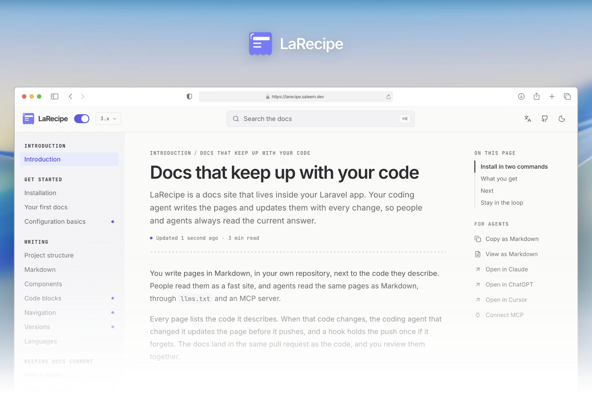

<p align="center">
<a href="https://larecipe.saleem.dev"></a>
</p>

<h1 align="center">Docs that keep up with your code</h1>

<p align="center">
LaRecipe is a docs site that lives inside your Laravel app.<br>
Your coding agent updates it in the same pull request as the code.
</p>

<p align="center">
<a href="https://github.com/saleem-hadad/larecipe/actions/workflows/tests.yml"></a>
<a href="https://github.com/saleem-hadad/larecipe/releases"></a>
<a href="https://packagist.org/packages/binarytorch/larecipe/stats"></a>
<a href="https://github.com/saleem-hadad/larecipe/stargazers"></a>
<a href="LICENSE"></a>
</p>

<p align="center">
<a href="https://larecipe.saleem.dev"><strong>See it live</strong></a> ·
<a href="#-get-started">Get started</a> ·
<a href="#-upgrading-from-larecipe-2">Upgrade from v2</a> ·
<a href="CHANGELOG.md">Changelog</a>
</p>

---

## 🚀 Get started

```bash
composer require larecipe/larecipe:^3.0
php artisan larecipe:install
```

Open `/docs`. Your docs site is ready, and your coding agents (Claude Code, Codex, Cursor, Gemini, Copilot) are set up to keep it current.

## 🔄 How it works

1. Each page lists the code it describes.
2. Your agent updates the affected pages before it pushes.
3. If it forgets, a hook holds the push and names the pages.
4. You review docs and code in the same pull request.

What your agent sees when it forgets:

```console
$ git push
LaRecipe: this push changes code that 1 docs page describes, and it was not updated:
  - docs/billing.md   (sources: app/Billing/**)
Update it with the larecipe-update-docs skill, run php artisan larecipe:validate,
show the user the docs diff and wait for approval, then commit and push again.
```

## ✨ Features

**For readers**

- A fast site, light and dark, right to left, phone to desktop
- Search in the browser, with no service to run
- Versions, languages and private docs
- Live references read from your running app
- Ask AI, with answers that cite your pages

**For agents**

- Every page as Markdown
- `llms.txt` and `llms-full.txt`
- An MCP server
- A skill for your docs

**[See it live at larecipe.saleem.dev →](https://larecipe.saleem.dev)** The LaRecipe docs are built with LaRecipe.

## ⬆️ Upgrading from LaRecipe 2

```bash
composer require larecipe/larecipe:^3.0
php artisan larecipe:upgrade
```

It starts as a dry run with a report. Add `--apply` to convert, then let your agent finish with the `larecipe-upgrade-v2` skill. Read the [upgrade guide](https://larecipe.saleem.dev/3.x/upgrade).

## 📋 Requirements

PHP 8.3+ and Laravel 12.62+ or 13. Ask AI needs `laravel/ai`.

## 🙌 Contributors

This project exists thanks to all the people who contribute. [Contribute](CONTRIBUTING.md).

<a href="https://github.com/saleem-hadad/larecipe/graphs/contributors"></a>

<details>
<summary>Work on LaRecipe locally</summary>

```bash
composer install
pnpm install
pnpm build              # the prebuilt UI in dist/
vendor/bin/pest         # PHP tests
pnpm test               # UI tests
pnpm test:browser       # browser tests against the workbench
```

</details>

## 📄 License

MIT. Made by [Saleem Hadad](https://github.com/saleem-hadad).

⭐ If LaRecipe saves you time, star the repo.
