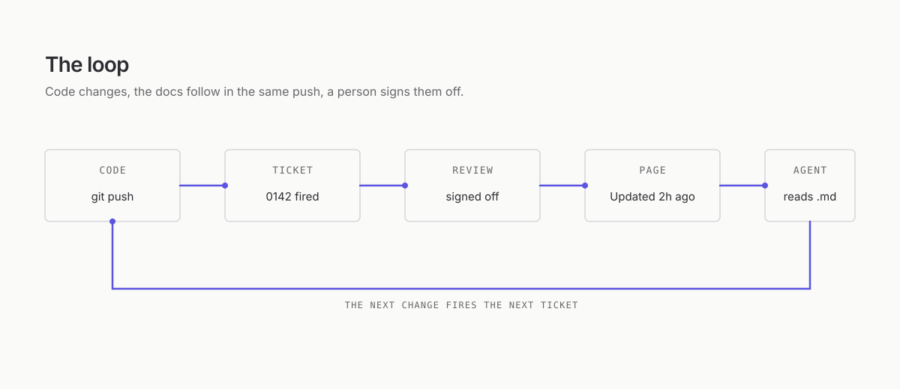
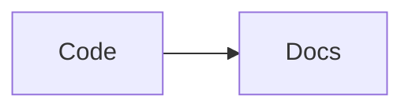

# Authoring components

This page is written in component syntax, so what you see is exactly what the renderer produces.

## Callouts

<Callout type="warning" title="Heads up">
Verify the **signature** before you trust a payload.
</Callout>

> [!TIP]
> GitHub alerts render as callouts too.

## Steps

<Steps>
<Step title="Install">
Run `composer require larecipe/larecipe`.
</Step>
<Step title="Configure">
Point `docs` at your folder in `config/larecipe.php`.
</Step>
</Steps>

## Tabs

<Tabs sync="pm">
<Tab label="npm">
Install the plugin with `npm install -D @larecipe/vite`.
</Tab>
<Tab label="pnpm">
Install the plugin with `pnpm add -D @larecipe/vite`.
</Tab>
</Tabs>

## Code

```php title="app/Http/Controllers/WebhookController.php" {3}
public function __invoke(Request $request): Response
{
    $event = Webhook::verify($request, config('billing.secret'));

    return response()->noContent();
}
```

```diff
- 'prefix' => 'docs',
+ 'prefix' => 'help',
```

<CodeGroup>
```bash title="Composer"
composer require larecipe/larecipe
```
```bash title="Artisan"
php artisan larecipe:install
```
</CodeGroup>

## Cards

<CardGroup cols="2">
<Card title="Installation" href="../installation.md">
Require the package and run the installer.
</Card>
<Card title="Components" href="../components.md">
Every component in its server HTML.
</Card>
</CardGroup>

## Accordion

<AccordionGroup>
<Accordion title="Does it need Node on the server?">
No. The UI ships prebuilt inside the package.
</Accordion>
</AccordionGroup>

## Media

<Frame caption="The loop">

</Frame>

<Video placeholder="Demo: the maintainer explains LaRecipe (2 min)" />

## Diagrams and math



$$
E = mc^2
$$
